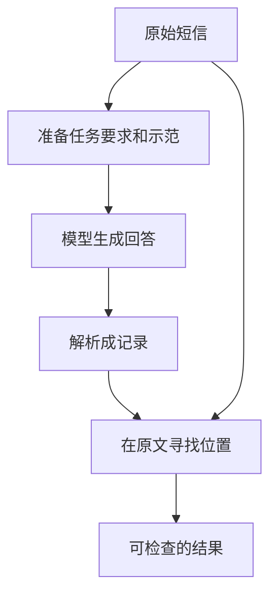

# 第 1 章　从读短信到信息抽取

## 1.1 先做一件小事

想象你下班回家，手机收到了三条短信：

> 顺丰快递已到菜鸟驿站，取件码 3821。
>
> 【中通】您的包裹到了，请凭 7619 领取。
>
> 今晚八点吃饭，别迟到。

你想写一个小程序，帮你把快递消息中的取件码记下来。最后最好得到一张表：

| 公司 | 取件码 |
|---|---|
| 顺丰 | 3821 |
| 中通 | 7619 |

第三条不是快递短信，不应该出现在表里。这件事看似简单，其实包含三个决定：哪些短信值得处理、从文字中找出什么、以及怎样保存找到的内容。

从不规则的文本中找出有用信息并整理成有组织的数据，这就是我们接下来要学习的**信息抽取**。

## 1.2 不用 AI 能不能做？

当然可以。先只处理第一条。

```python
text = "顺丰快递已到菜鸟驿站，取件码 3821。"
code = text.split("取件码")[1].strip(" 。")
print(code)
```

执行结果是 `3821`。split 将文字分成两段，取第二段，再去掉首尾的空格和句号。我们已经有了一个小小的信息抽取程序。

不过，换成第二条短信就会报错，因为其中根本没有“取件码”三个字。这不是 Python 的缺陷，而是我们作出的假设不再成立。

试试用正则表达式（描述字符串形状的规则）：

```python
import re

def extract_code(text):
    match = re.search(r"(?<!\d)\d{4}(?!\d)", text)
    return match.group() if match else None

print(extract_code("【中通】请凭 7619 领取。"))
print(extract_code("会员活动编号 2026。"))
```

两个数字都被找到了。我们发现了一个更加根本的困难：数字的形状一样，并不意味着它们的含义一样。再加十条规则或许有用，但每个快递公司可能换模板，取件码还可能是 6-3-1202。规则可以非常可靠地解决固定格式的问题，却不能自动理解一条陌生的通知。

## 1.3 找一个会看文字的助手

大语言模型（LLM）可以接收一段文字，并根据指令生成另一段文字。先把它想成一位擅长阅读短信的助手，而不要把它想成一个总能给出正确答案的数据库。

如果告诉它“从下面的短信中找出快递公司和取件码，不要编造”，它可能回复：

> 这条短信来自中通，取件码是 7619。

人能读懂，但程序怎么继续处理？我们的程序得再次分析这句话。如果助手换个说法，又会遇到上一节的困难。

请助手按约定填写表格。比如输出以下 JSON 文本：

```json
{"extractions": [{"company": "中通"}, {"pickup_code": "7619"}]}
```

JSON 是一种数据交换格式；它看起来像 Python 字典，但其实在网络中传来的是字符串。Python 的标准库可以把它变成字典。

```python
import json

answer = '{"extractions": [{"company": "中通"}, {"pickup_code": "7619"}]}'
result = json.loads(answer)
for item in result["extractions"]:
    print(item)
```

这就是第一版的基本分工：模型负责理解文字，普通 Python 代码负责管理数据。

## 1.4 不能只有答案，还要有证据

助手如果把 7619 看成 7691 怎么办？我们需要能够回到原短信，检查答案是不是确实出现在对应位置。假设要标记的位置是 `start` 到 `end`，Python 已经有非常适合的表达方式：

```python
text = "【中通】请凭 7619 领取。"
value = "7619"
start = text.find(value)
if start != -1:
    end = start + len(value)
    assert text[start:end] == value
    print(start, end, text[start:end])
```

这段操作叫做定位证据。找不到的时候，不能假装找到了。模型能给出一个正确的数字，但也可能给出原文中没有的数字。

现在我们已经遇到 LangExtract 的三个基础需求：

- 让模型理解抽取任务，而不只是任意聊天。
- 把模型回答转化成程序可以处理的记录。
- 把记录和原文连接起来，让结果可检查。

除此以外，还要解决长文本、多个文档、不同模型服务、失败恢复等实际工程问题。它们会在具体问题出现时再引入。

## 1.5 一张暂时够用的路线图



这不是源码模块图，而是我们自己刚刚发现的解决问题的过程。后面的章节会逐步把图中的每一步实现出来。

动手练习：添加一条同时有订单号和取件码的短信，试着用正则分辨它们。你会发现“需要理解含义”不是一个抽象的宣传词，而是规则方案遇到的具体限制。
