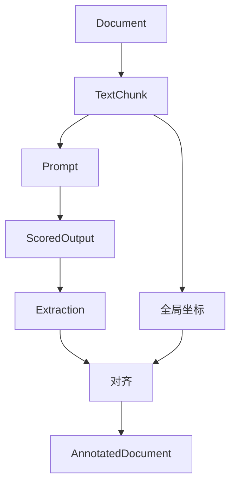

# 第 11 章　把所有步骤串起来

快递站已经有了收件箱、分拣器、登记卡和查找原文的工具。可我们不能每收到一封短信就手工调用六七个函数。我们想要的是：把一堆短信交给一个工作人员，得到按来源整理好的登记结果。

## 11.1 先搭建一条最小流水线

```python
import re
import json

def fake_model(batch):
    for text in batch:
        yield json.dumps([{"code": word}
                          for word in re.findall(r"\d{4}", text)])

documents = [("a", "Pickup 3821."), ("b", "Pickup 9246.")]
answers = fake_model([text for _, text in documents])
for (doc_id, text), answer in zip(documents, answers):
    for item in json.loads(answer):
        start = text.index(item["code"])
        print(doc_id, item["code"], start, start + len(item["code"]))
```

模型是假的，但五个阶段都出现了：接收原件、准备请求、获得答卷、解析答卷、找回原件位置。我们希望换真实模型时，不必改变其余步骤。



这里的协调组件叫 Annotator，不是具体的模型或分词器。它使用前面十章的工具，安排调用顺序。

## 11.2 多篇文档如何变成同一条信封流

先给每份记录一个唯一编号。如果两份不同文档都叫 a，下游不知道应把哪张卡放回哪份文档。

源码出处：[langextract/annotation.py:118–160](https://github.com/google/langextract/blob/b3499195e5ee711d3bb7da5178ba40456046f5f3/langextract/annotation.py#L118-L160)。

````python
def _document_chunk_iterator(
    documents: Iterable[data.Document],
    max_char_buffer: int,
    restrict_repeats: bool = True,
    tokenizer: tokenizer_lib.Tokenizer | None = None,
) -> Iterator[chunking.TextChunk]:
  """Iterates over documents to yield text chunks along with the document ID.

  Args:
    documents: A sequence of Document objects.
    max_char_buffer: The maximum character buffer size for the ChunkIterator.
    restrict_repeats: Whether to restrict the same document id from being
      visited more than once.
    tokenizer: Optional tokenizer instance.

  Yields:
    TextChunk containing document ID for a corresponding document.

  Raises:
    InvalidDocumentError: If restrict_repeats is True and the same document ID
      is visited more than once. Valid documents prior to the error will be
      returned.
  """
  visited_ids = set()
  for document in documents:
    if tokenizer:
      tokenized_text = tokenizer.tokenize(document.text or "")
    else:
      tokenized_text = document.tokenized_text
    document_id = document.document_id
    if restrict_repeats and document_id in visited_ids:
      raise exceptions.InvalidDocumentError(
          f"Document id {document_id} is already visited."
      )
    chunk_iter = chunking.ChunkIterator(
        text=tokenized_text,
        max_char_buffer=max_char_buffer,
        document=document,
        tokenizer_impl=tokenizer or tokenizer_lib.RegexTokenizer(),
    )
    visited_ids.add(document_id)

    yield from chunk_iter
````

_document_chunk_iterator 逐份消费 Iterable[Document]，使用指定 tokenizer 或文档自带的 tokenized_text，检查重复 ID，再构造 ChunkIterator，把当前文档引用一并传入。visited_ids 是集合；restrict_repeats 默认 True，同一编号第二次出现会抛 InvalidDocumentError。此前已经 yield 的有效块不受撤销。

yield from chunk_iter 把一个子迭代器中的所有输出接到当前生成器。它不是把迭代器本身当作单个元素返回：

```python
def flatten(groups):
    for group in groups:
        yield from group

assert list(flatten([[1, 2], [3], []])) == [1, 2, 3]
```

因此分批器可以跨文档组装一批信封，模型不需要每遇到新文档就单独调用。

## 11.3 建立协调器

源码出处：[langextract/annotation.py:166–207](https://github.com/google/langextract/blob/b3499195e5ee711d3bb7da5178ba40456046f5f3/langextract/annotation.py#L166-L207)。

````python
  def __init__(
      self,
      language_model: base_model.BaseLanguageModel,
      prompt_template: prompting.PromptTemplateStructured,
      format_type: data.FormatType = data.FormatType.YAML,
      attribute_suffix: str = data.ATTRIBUTE_SUFFIX,
      fence_output: bool = False,
      format_handler: fh.FormatHandler | None = None,
  ):
    """Initializes Annotator.

    Args:
      language_model: Model which performs language model inference.
      prompt_template: Structured prompt template where the answer is expected
        to be formatted text (YAML or JSON).
      format_type: The format type for the output (YAML or JSON).
      attribute_suffix: Suffix to append to attribute keys in the output.
      fence_output: Whether to expect/generate fenced output (```json or
        ```yaml). When True, the model is prompted to generate fenced output and
        the resolver expects it. When False, raw JSON/YAML is expected.
        Defaults to False. If format_handler is provided, it takes precedence.
      format_handler: Optional FormatHandler for managing format-specific logic.
    """
    self._language_model = language_model

    if format_handler is None:
      format_handler = fh.FormatHandler(
          format_type=format_type,
          use_wrapper=True,
          wrapper_key=data.EXTRACTIONS_KEY,
          use_fences=fence_output,
          attribute_suffix=attribute_suffix,
      )

    self._prompt_generator = prompting.QAPromptGenerator(
        template=prompt_template,
        format_handler=format_handler,
    )

    logging.debug(
        "Annotator initialized with format_handler: %s", format_handler
    )
````

Annotator 保存模型以及一个 QAPromptGenerator。构造方法优先采用给定 FormatHandler，否则根据 format_type、属性后缀和 fence_output 建立默认包装格式。它没有在初始化时调用模型、读完文档或写文件。把这些依赖传进来，便可以用假的模型和假的 resolver 测试实际协调逻辑。

类的完整源码：[Annotator:163–638](https://github.com/google/langextract/blob/b3499195e5ee711d3bb7da5178ba40456046f5f3/langextract/annotation.py#L163-L638)。各方法分布在本章。它提供两种输入接口：annotate_documents 接收文档流，annotate_text 为单个字符串补上文档包装。两种入口最终共享一个核心处理过程，而不是分别实现一套抽取算法。

源码出处：[langextract/annotation.py:209–284](https://github.com/google/langextract/blob/b3499195e5ee711d3bb7da5178ba40456046f5f3/langextract/annotation.py#L209-L284)。

````python
  def annotate_documents(
      self,
      documents: Iterable[data.Document],
      resolver: resolver_lib.AbstractResolver | None = None,
      max_char_buffer: int = 200,
      batch_length: int = 1,
      debug: bool = True,
      extraction_passes: int = 1,
      context_window_chars: int | None = None,
      show_progress: bool = True,
      tokenizer: tokenizer_lib.Tokenizer | None = None,
      **kwargs,
  ) -> Iterator[data.AnnotatedDocument]:
    """Annotates a sequence of documents with NLP extractions.

      Breaks documents into chunks, processes them into prompts and performs
      batched inference, mapping annotated extractions back to the original
      document. Batch processing is determined by batch_length, and can operate
      across documents for optimized throughput.

    Args:
      documents: Documents to annotate. Each document is expected to have a
        unique document_id.
      resolver: Resolver to use for extracting information from text.
      max_char_buffer: Max number of characters that we can run inference on.
        The text will be broken into chunks up to this length.
      batch_length: Number of chunks to process in a single batch.
      debug: Whether to populate debug fields.
      extraction_passes: Number of sequential extraction attempts to improve
        recall by finding additional entities. Defaults to 1, which performs
        standard single extraction.
        Values > 1 reprocess tokens multiple times, potentially increasing
        costs with the potential for a more thorough extraction.
      context_window_chars: Number of characters from the previous chunk to
        include as context for the current chunk. Helps with coreference
        resolution across chunk boundaries. Defaults to None (disabled).
      show_progress: Whether to show progress bar. Defaults to True.
      tokenizer: Optional tokenizer to use. If None, uses default tokenizer.
      **kwargs: Additional arguments passed to LanguageModel.infer and
        Resolver. Alignment settings (resolver.ALIGNMENT_PARAM_KEYS) go only
        to the Resolver.

    Yields:
      Resolved annotations from input documents.

    Raises:
      ValueError: If there are no scored outputs during inference.
    """
    if resolver is None:
      resolver = resolver_lib.Resolver(format_type=data.FormatType.YAML)

    if extraction_passes == 1:
      yield from self._annotate_documents_single_pass(
          documents,
          resolver,
          max_char_buffer,
          batch_length,
          debug,
          show_progress,
          context_window_chars=context_window_chars,
          tokenizer=tokenizer,
          **kwargs,
      )
    else:
      yield from self._annotate_documents_sequential_passes(
          documents,
          resolver,
          max_char_buffer,
          batch_length,
          debug,
          extraction_passes,
          show_progress,
          context_window_chars=context_window_chars,
          tokenizer=tokenizer,
          **kwargs,
      )
````

annotate_documents 建立缺省 YAML Resolver（注意这是 Annotator 的直接接口，公开 extract API 另有 JSON 默认设置），然后按 extraction_passes 分支。一次就走流式单轮；其他次数交给多轮方法。yield from 让最终调用者以相同方式消费结果，不需要知道内部选了哪条路径。

## 11.4 流水线为什么要记文档顺序

假设 A 拆成 A1、A2，B 拆成 B1、B2，每批装三块。第一批包含 A1、A2、B1，第二批包含 B2。第一批处理完时 A 已完整，可以交付；B 还不能交付，否则 B2 的结果就会丢失。

```python
from collections import defaultdict

def collect(batches):
    records = defaultdict(list)
    active = None
    for batch in batches:
        for doc_id, value in batch:
            if active is not None and active != doc_id:
                yield active, records.pop(active)
            active = doc_id
            records[doc_id].append(value)
    if active is not None:
        yield active, records.pop(active)

assert list(collect([[("A", 1), ("A", 2), ("B", 3)],
                     [("B", 4)]])) == [("A", [1, 2]), ("B", [3, 4])]
```

教学版本假设每个文档至少一块且输入按文档连续。实际代码还要保留没有 token 的文档、保存原文、处理生成器模型，并在每批之后判断完成边界。

源码出处：[langextract/annotation.py:286–457](https://github.com/google/langextract/blob/b3499195e5ee711d3bb7da5178ba40456046f5f3/langextract/annotation.py#L286-L457)。

````python
  def _annotate_documents_single_pass(
      self,
      documents: Iterable[data.Document],
      resolver: resolver_lib.AbstractResolver,
      max_char_buffer: int,
      batch_length: int,
      debug: bool,
      show_progress: bool = True,
      context_window_chars: int | None = None,
      tokenizer: tokenizer_lib.Tokenizer | None = None,
      suppress_parse_errors: bool = False,
      **kwargs,
  ) -> Iterator[data.AnnotatedDocument]:
    """Single-pass annotation with stable ordering and streaming emission.

    Streams input without full materialization, maintains correct attribution
    across batches, and emits completed documents immediately to minimize
    peak memory usage. Handles generators from both infer() and align().

    When context_window_chars is set, includes text from the previous chunk as
    context for coreference resolution across chunk boundaries.
    """
    # Alignment settings are for the resolver; providers that forward unknown
    # kwargs to their API (Ollama does) would otherwise send them too.
    infer_kwargs = {
        key: value
        for key, value in kwargs.items()
        if key not in resolver_lib.ALIGNMENT_PARAM_KEYS
    }
    doc_order: list[str] = []
    doc_text_by_id: dict[str, str] = {}
    per_doc: DefaultDict[str, list[data.Extraction]] = collections.defaultdict(
        list
    )
    next_emit_idx = 0

    def _capture_docs(src: Iterable[data.Document]) -> Iterator[data.Document]:
      """Captures document order and text lazily as chunks are produced."""
      for document in src:
        document_id = document.document_id
        if document_id in doc_text_by_id:
          raise exceptions.InvalidDocumentError(
              f"Duplicate document_id: {document_id}"
          )
        doc_order.append(document_id)
        doc_text_by_id[document_id] = document.text or ""
        yield document

    def _emit_docs_iter(
        keep_last_doc: bool,
    ) -> Iterator[data.AnnotatedDocument]:
      """Yields documents that are guaranteed complete.

      Args:
        keep_last_doc: If True, retains the most recently started document
          for additional extractions. If False, emits all remaining documents.
      """
      nonlocal next_emit_idx
      limit = max(0, len(doc_order) - 1) if keep_last_doc else len(doc_order)
      while next_emit_idx < limit:
        document_id = doc_order[next_emit_idx]
        yield data.AnnotatedDocument(
            document_id=document_id,
            extractions=per_doc.get(document_id, []),
            text=doc_text_by_id.get(document_id, ""),
        )
        per_doc.pop(document_id, None)
        doc_text_by_id.pop(document_id, None)
        next_emit_idx += 1

    chunk_iter = _document_chunk_iterator(
        _capture_docs(documents), max_char_buffer, tokenizer=tokenizer
    )
    batches = chunking.make_batches_of_textchunk(chunk_iter, batch_length)

    model_info = progress.get_model_info(self._language_model)
    batch_iter = progress.create_extraction_progress_bar(
        batches, model_info=model_info, disable=not show_progress
    )

    chars_processed = 0

    prompt_builder = prompting.ContextAwarePromptBuilder(
        generator=self._prompt_generator,
        context_window_chars=context_window_chars,
    )

    try:
      for batch in batch_iter:
        if not batch:
          continue

        prompts = [
            prompt_builder.build_prompt(
                chunk.chunk_text, chunk.document_id, chunk.additional_context
            )
            for chunk in batch
        ]

        if show_progress:
          current_chars = sum(
              len(text_chunk.chunk_text) for text_chunk in batch
          )
          try:
            batch_iter.set_description(
                progress.format_extraction_progress(
                    model_info,
                    current_chars=current_chars,
                    processed_chars=chars_processed,
                )
            )
          except AttributeError:
            pass

        outputs = self._language_model.infer(
            batch_prompts=prompts, **infer_kwargs
        )
        if not isinstance(outputs, list):
          outputs = list(outputs)
        # Avoid retaining these prompts while constructing the next batch.
        del prompts

        for text_chunk, scored_outputs in zip(batch, outputs):
          if not isinstance(scored_outputs, list):
            scored_outputs = list(scored_outputs)
          if not scored_outputs:
            raise exceptions.InferenceOutputError(
                "No scored outputs from language model."
            )

          resolved_extractions = resolver.resolve(
              scored_outputs[0].output,
              debug=debug,
              suppress_parse_errors=suppress_parse_errors,
              **kwargs,
          )

          token_offset = (
              text_chunk.token_interval.start_index
              if text_chunk.token_interval
              else 0
          )
          char_offset = (
              text_chunk.char_interval.start_pos
              if text_chunk.char_interval
              else 0
          )

          aligned_extractions = resolver.align(
              resolved_extractions,
              text_chunk.chunk_text,
              token_offset,
              char_offset,
              tokenizer_inst=tokenizer,
              **kwargs,
          )

          for extraction in aligned_extractions:
            per_doc[text_chunk.document_id].append(extraction)

          if show_progress and text_chunk.char_interval is not None:
            chars_processed += (
                text_chunk.char_interval.end_pos
                - text_chunk.char_interval.start_pos
            )

        yield from _emit_docs_iter(keep_last_doc=True)

    finally:
      batch_iter.close()

    yield from _emit_docs_iter(keep_last_doc=False)
````

这个方法是整条流水线的心脏。不要被它的长度吓到，分成下面六步读：

1. 参数分流：infer_kwargs 去掉 ALIGNMENT_PARAM_KEYS 中的参数，防止比如 fuzzy_alignment_threshold 被模型服务当成不认识的参数。这些选项应该只交给 resolver。doc_order 保存顺序，doc_text_by_id 保存暂存原文，per_doc 用 defaultdict(list) 收集卡片，next_emit_idx 是下一篇要交付的索引。
2. 输入阶段：内部生成器 _capture_docs 在上游按需请求文档时，记下 ID 和原文。若当前暂存表已有该 ID 就报重复错误；另外 _document_chunk_iterator 维护已访问 ID。空文档也会被捕获，即使它没有产出块。
3. 分批阶段：用第 8 章的分批器，再包一层进度条。ContextAwarePromptBuilder 为每个块建立提示词，可带上文档背景与同文档前一块的上下文。背景不成为当前证据的坐标来源。
4. 推理阶段：把 prompts 交给 infer，将非 list 的输出物化，之后用 zip(batch, outputs) 配对。每项也可为迭代器，物化后必须非空，否则抛 InferenceOutputError。这里只读取 scored_outputs[0].output；没有重新比较得分，也没有做批量长度严格相等的检查（zip 会截断）。
5. 录入与对齐：resolve 解析答卷，align 在当前 chunk_text 中定位并分别传入 token 和字符偏移。比如块起点字符 100，块内证据 [8,12)，最终 [108,112)。逐卡追加到 per_doc 的对应文档。进度统计使用块的字符区间长度，而非模型 token 计费数。
6. 输出阶段：每批后调用 _emit_docs_iter(keep_last_doc=True)，保留最近开始的一篇，其余已捕获文档按顺序交付；finally 关闭进度条，即使途中抛异常也清理显示。正常读完所有批次后，再以 keep_last_doc=False 交付余下文档。

两个内嵌函数还值得单独看。_capture_docs 是包装输入的生成器，并不自行产生新文档；它在 yield 之前记录信息，让下游开始处理第一个块时就能登记归属。

_emit_docs_iter 使用 nonlocal 修改外部 next_emit_idx。keep_last_doc 为真时 limit 是捕获数量减一（最低为 0），否则是全部。每 yield 一个 AnnotatedDocument，恢复执行时删除其 per_doc 和原文缓存，再递增索引。doc_order 和 visited_ids 仍保留，因此流式并非严格常数内存；主要节省的是已完成文档的文字与抽取列表占用。

## 11.5 进度不是另一条业务流水线

屏幕上显示「正在处理 1000 字，已处理 2000 字」不应该改变抽取结果。progress.py 使用 tqdm 包装迭代器或手动更新显示，颜色使用 ANSI 转义序列。

源码出处：[langextract/progress.py:253–268](https://github.com/google/langextract/blob/b3499195e5ee711d3bb7da5178ba40456046f5f3/langextract/progress.py#L253-L268)。

````python
def get_model_info(language_model: Any) -> str | None:
  """Extract model information from a language model instance.

  Args:
    language_model: A language model instance.

  Returns:
    A string describing the model, or None if not available.
  """
  if hasattr(language_model, "model_id"):
    return language_model.model_id

  if hasattr(language_model, "model_url"):
    return language_model.model_url

  return None
````

get_model_info 优先读取 model_id，其次 model_url，都没有返回 None。用 hasattr 允许不同服务的模型对象有不同字段，主要供界面展示。

源码出处：[langextract/progress.py:301–328](https://github.com/google/langextract/blob/b3499195e5ee711d3bb7da5178ba40456046f5f3/langextract/progress.py#L301-L328)。

````python
def format_extraction_progress(
    model_info: str | None,
    current_chars: int | None = None,
    processed_chars: int | None = None,
) -> str:
  """Format the complete extraction progress bar description.

  Args:
    model_info: Optional model information (e.g., "gemini-2.0-flash").
    current_chars: Number of characters in current batch (optional).
    processed_chars: Total number of characters processed so far (optional).

  Returns:
    Formatted description string.
  """
  # Base description
  if model_info:
    desc = f"{BLUE}{BOLD}LangExtract{RESET}: model={GREEN}{model_info}{RESET}"
  else:
    desc = f"{BLUE}{BOLD}LangExtract{RESET}: Processing"

  # Add stats if provided
  if current_chars is not None and processed_chars is not None:
    current_str = f"{GREEN}{current_chars:,}{RESET}"
    processed_str = f"{GREEN}{processed_chars:,}{RESET}"
    desc += f", current={current_str} chars, processed={processed_str} chars"

  return desc
````

format_extraction_progress 拼装包含模型名或 Processing 的描述；只有 current_chars 与 processed_chars 都非 None 才附加带千位分隔的字符数，零也会显示。

源码出处：[langextract/progress.py:81–102](https://github.com/google/langextract/blob/b3499195e5ee711d3bb7da5178ba40456046f5f3/langextract/progress.py#L81-L102)。

````python
def create_extraction_progress_bar(
    iterable: Any, model_info: str | None = None, disable: bool = False
) -> tqdm.tqdm:
  """Create a styled progress bar for extraction.

  Args:
    iterable: The iterable to wrap with progress bar.
    model_info: Optional model information to display (e.g., "gemini-1.5-pro").
    disable: Whether to disable the progress bar.

  Returns:
    A configured tqdm progress bar.
  """
  desc = format_extraction_progress(model_info)

  return tqdm.tqdm(
      iterable,
      desc=desc,
      bar_format="{desc} [{elapsed}]",
      disable=disable,
      dynamic_ncols=True,
  )
````

create_extraction_progress_bar 用上面的描述包装 iterable，disable 控制是否显示，dynamic_ncols 自适应宽度；没有要求预先知道迭代器总长度。

源码出处：[langextract/progress.py:271–283](https://github.com/google/langextract/blob/b3499195e5ee711d3bb7da5178ba40456046f5f3/langextract/progress.py#L271-L283)。

````python
def format_extraction_stats(current_chars: int, processed_chars: int) -> str:
  """Format extraction progress statistics with colors.

  Args:
    current_chars: Number of characters in current batch.
    processed_chars: Total number of characters processed so far.

  Returns:
    Formatted string with colored statistics.
  """
  current_str = f"{GREEN}{current_chars:,}{RESET}"
  processed_str = f"{GREEN}{processed_chars:,}{RESET}"
  return f"current={current_str} chars, processed={processed_str} chars"
````
源码出处：[langextract/progress.py:286–298](https://github.com/google/langextract/blob/b3499195e5ee711d3bb7da5178ba40456046f5f3/langextract/progress.py#L286-L298)。

````python
def create_extraction_postfix(current_chars: int, processed_chars: int) -> str:
  """Create a formatted postfix string for extraction progress.

  Args:
    current_chars: Number of characters in current batch.
    processed_chars: Total number of characters processed so far.

  Returns:
    Formatted string with statistics.
  """
  current_str = f"{GREEN}{current_chars:,}{RESET}"
  processed_str = f"{GREEN}{processed_chars:,}{RESET}"
  return f"current={current_str} chars, processed={processed_str} chars"
````

这两个辅助函数目前实现相同，输入是当前批字符数与累计字符数，返回彩色统计字符串。前者用于统计格式，后者命名为进度条后缀；不是两套不同的计数算法。

源码出处：[langextract/progress.py:122–124](https://github.com/google/langextract/blob/b3499195e5ee711d3bb7da5178ba40456046f5f3/langextract/progress.py#L122-L124)。

````python
def print_extraction_complete() -> None:
  """Print a generic extraction completion message."""
  print(f"{GREEN}✓{RESET} Extraction processing complete", flush=True)
````

print_extraction_complete 输出通用完成消息并 flush，不返回统计对象。

源码出处：[langextract/progress.py:127–164](https://github.com/google/langextract/blob/b3499195e5ee711d3bb7da5178ba40456046f5f3/langextract/progress.py#L127-L164)。

````python
def print_extraction_summary(
    num_extractions: int,
    unique_classes: int,
    elapsed_time: float | None = None,
    chars_processed: int | None = None,
    num_chunks: int | None = None,
) -> None:
  """Print a styled extraction summary with optional performance metrics.

  Args:
    num_extractions: Total number of extractions.
    unique_classes: Number of unique extraction classes.
    elapsed_time: Optional elapsed time in seconds.
    chars_processed: Optional number of characters processed.
    num_chunks: Optional number of chunks processed.
  """
  print(
      f"{GREEN}✓{RESET} Extracted {BOLD}{num_extractions}{RESET} entities "
      f"({BOLD}{unique_classes}{RESET} unique types)",
      flush=True,
  )

  if elapsed_time is not None:
    metrics = []

    # Time
    metrics.append(f"Time: {BOLD}{elapsed_time:.2f}s{RESET}")

    # Speed
    if chars_processed is not None and elapsed_time > 0:
      speed = chars_processed / elapsed_time
      metrics.append(f"Speed: {BOLD}{speed:,.0f}{RESET} chars/sec")

    if num_chunks is not None:
      metrics.append(f"Chunks: {BOLD}{num_chunks}{RESET}")

    for metric in metrics:
      print(f"  {CYAN}•{RESET} {metric}", flush=True)
````

print_extraction_summary 显示抽取数量和类别数。有耗时时显示时间，字符数已知且耗时正数时计算 chars/sec，块数可选。速度是吞吐估计，不是模型准确率。

源码出处：[langextract/progress.py:331–353](https://github.com/google/langextract/blob/b3499195e5ee711d3bb7da5178ba40456046f5f3/langextract/progress.py#L331-L353)。

````python
def create_pass_progress_bar(
    total_passes: int, disable: bool = False
) -> tqdm.tqdm:
  """Create a progress bar for sequential extraction passes.

  Args:
    total_passes: Total number of sequential passes.
    disable: Whether to disable the progress bar.

  Returns:
    A configured tqdm progress bar.
  """
  desc = f"{BLUE}{BOLD}LangExtract{RESET}: Extraction passes"
  return tqdm.tqdm(
      total=total_passes,
      desc=desc,
      bar_format=(
          "{desc}: {percentage:3.0f}%|{bar}| {n_fmt}/{total_fmt} [{elapsed}]"
      ),
      disable=disable,
      colour=GOOGLE_BLUE,
      ncols=100,
  )
````

create_pass_progress_bar 给已知轮数建立总量进度条，显示百分比、已处理轮数和耗时；当前多轮协调器本身只在第一轮显示普通抽取进度，不要误以为一定调用此函数。

## 11.6 再看一遍可以找到遗漏吗？

人复查表格可能发现第一次漏掉的取件码，模型的多轮抽取也类似。代价是重复调用。两个结果怎样合并？如果新卡和旧卡占据同一字符位置，我们先保留旧卡。

```python
def overlap(a, b):
    return a[0] < b[1] and b[0] < a[1]

assert not overlap((0, 4), (4, 8))
assert overlap((0, 4), (3, 8))
```

源码出处：[langextract/annotation.py:87–115](https://github.com/google/langextract/blob/b3499195e5ee711d3bb7da5178ba40456046f5f3/langextract/annotation.py#L87-L115)。

````python
def _extractions_overlap(
    extraction1: data.Extraction, extraction2: data.Extraction
) -> bool:
  """Checks if two extractions overlap based on their character intervals.

  Args:
    extraction1: First extraction to compare.
    extraction2: Second extraction to compare.

  Returns:
    True if the extractions overlap, False otherwise.
  """
  if extraction1.char_interval is None or extraction2.char_interval is None:
    return False

  start1, end1 = (
      extraction1.char_interval.start_pos,
      extraction1.char_interval.end_pos,
  )
  start2, end2 = (
      extraction2.char_interval.start_pos,
      extraction2.char_interval.end_pos,
  )

  if start1 is None or end1 is None or start2 is None or end2 is None:
    return False

  # Two intervals overlap if one starts before the other ends
  return start1 < end2 and start2 < end1
````

_extractions_overlap 对两张卡检查半开字符区间；缺任一区间或任一端点为 None 都返回 False。仅靠文字相等不能判断重叠，同一个取件码在文档中两处出现应该保留。

源码出处：[langextract/annotation.py:46–84](https://github.com/google/langextract/blob/b3499195e5ee711d3bb7da5178ba40456046f5f3/langextract/annotation.py#L46-L84)。

````python
def _merge_non_overlapping_extractions(
    all_extractions: list[Iterable[data.Extraction]],
) -> list[data.Extraction]:
  """Merges extractions from multiple extraction passes.

  When extractions from different passes overlap in their character positions,
  the extraction from the earlier pass is kept (first-pass wins strategy).
  Only non-overlapping extractions from later passes are added to the result.

  Args:
    all_extractions: List of extraction iterables from different sequential
      extraction passes, ordered by pass number.

  Returns:
    List of merged extractions with overlaps resolved in favor of earlier
    passes.
  """
  if not all_extractions:
    return []

  if len(all_extractions) == 1:
    return list(all_extractions[0])

  merged_extractions = list(all_extractions[0])

  for pass_extractions in all_extractions[1:]:
    for extraction in pass_extractions:
      overlaps = False
      if extraction.char_interval is not None:
        for existing_extraction in merged_extractions:
          if existing_extraction.char_interval is not None:
            if _extractions_overlap(extraction, existing_extraction):
              overlaps = True
              break

      if not overlaps:
        merged_extractions.append(extraction)

  return merged_extractions
````

_merge_non_overlapping_extractions 空输入返回 []，一轮直接返回其列表，第一轮所有卡原样保留。随后每张新卡与已经保留的卡比较，只要存在重叠就舍弃，否则追加。因此它不是全局去重或跨度排序；首轮内部重叠仍保留，无坐标的卡也可能重复。最坏情况下两两比较的成本会随卡片数平方增长。

源码出处：[langextract/annotation.py:459–542](https://github.com/google/langextract/blob/b3499195e5ee711d3bb7da5178ba40456046f5f3/langextract/annotation.py#L459-L542)。

````python
  def _annotate_documents_sequential_passes(
      self,
      documents: Iterable[data.Document],
      resolver: resolver_lib.AbstractResolver,
      max_char_buffer: int,
      batch_length: int,
      debug: bool,
      extraction_passes: int,
      show_progress: bool = True,
      context_window_chars: int | None = None,
      tokenizer: tokenizer_lib.Tokenizer | None = None,
      **kwargs,
  ) -> Iterator[data.AnnotatedDocument]:
    """Sequential extraction passes logic for improved recall."""

    logging.info(
        "Starting sequential extraction passes for improved recall with %d"
        " passes.",
        extraction_passes,
    )

    document_list = list(documents)

    document_extractions_by_pass: dict[str, list[list[data.Extraction]]] = {}
    document_texts: dict[str, str] = {}
    # Preserve text up-front so we can emit documents even if later passes
    # produce no extractions.
    for _doc in document_list:
      document_texts[_doc.document_id] = _doc.text or ""

    for pass_num in range(extraction_passes):
      logging.info(
          "Starting extraction pass %d of %d", pass_num + 1, extraction_passes
      )

      for annotated_doc in self._annotate_documents_single_pass(
          document_list,
          resolver,
          max_char_buffer,
          batch_length,
          debug=(debug and pass_num == 0),
          show_progress=show_progress if pass_num == 0 else False,
          context_window_chars=context_window_chars,
          tokenizer=tokenizer,
          **kwargs,
      ):
        doc_id = annotated_doc.document_id

        if doc_id not in document_extractions_by_pass:
          document_extractions_by_pass[doc_id] = []
          # Keep first-seen text (already pre-filled above).

        document_extractions_by_pass[doc_id].append(
            annotated_doc.extractions or []
        )

    # Emit results strictly in original input order.
    for doc in document_list:
      doc_id = doc.document_id
      all_pass_extractions = document_extractions_by_pass.get(doc_id, [])
      merged_extractions = _merge_non_overlapping_extractions(
          all_pass_extractions
      )

      if debug:
        total_extractions = sum(
            len(extractions) for extractions in all_pass_extractions
        )
        logging.info(
            "Document %s: Merged %d extractions from %d passes into "
            "%d non-overlapping extractions.",
            doc_id,
            total_extractions,
            extraction_passes,
            len(merged_extractions),
        )

      yield data.AnnotatedDocument(
          document_id=doc_id,
          extractions=merged_extractions,
          text=document_texts.get(doc_id, doc.text or ""),
      )

    logging.info("Sequential extraction passes completed.")
````

多轮方法先把 documents 变成可反复遍历的列表，预留原文。依次执行单轮方法，按文档 ID 保存各轮抽取列表。只有第一轮启用传入 debug 和 show_progress，其他配置照常传递。最后按原始 document_list 顺序取各轮结果合并，并构造 AnnotatedDocument。与单轮不同，多轮必须保留中间结果直到全部完成，因此增加内存与调用费用。

## 11.7 只有一条短信呢？

源码出处：[langextract/annotation.py:544–638](https://github.com/google/langextract/blob/b3499195e5ee711d3bb7da5178ba40456046f5f3/langextract/annotation.py#L544-L638)。

````python
  def annotate_text(
      self,
      text: str,
      resolver: resolver_lib.AbstractResolver | None = None,
      max_char_buffer: int = 200,
      batch_length: int = 1,
      additional_context: str | None = None,
      debug: bool = True,
      extraction_passes: int = 1,
      context_window_chars: int | None = None,
      show_progress: bool = True,
      tokenizer: tokenizer_lib.Tokenizer | None = None,
      **kwargs,
  ) -> data.AnnotatedDocument:
    """Annotates text with NLP extractions for text input.

    Args:
      text: Source text to annotate.
      resolver: Resolver to use for extracting information from text.
      max_char_buffer: Max number of characters that we can run inference on.
        The text will be broken into chunks up to this length.
      batch_length: Number of chunks to process in a single batch.
      additional_context: Additional context to supplement prompt instructions.
      debug: Whether to populate debug fields.
      extraction_passes: Number of sequential extraction passes to improve
        recall by finding additional entities. Defaults to 1, which performs
        standard single extraction. Values > 1 reprocess tokens multiple times,
        potentially increasing costs.
      context_window_chars: Number of characters from the previous chunk to
        include as context for coreference resolution. Defaults to None
        (disabled).
      show_progress: Whether to show progress bar. Defaults to True.
      tokenizer: Optional tokenizer instance.
      **kwargs: Additional arguments for inference and resolver_lib.
        Alignment settings go only to the resolver.

    Returns:
      Resolved annotations from text for document.
    """
    if resolver is None:
      resolver = resolver_lib.Resolver(
          format_type=data.FormatType.YAML,
      )

    start_time = time.time() if debug else None

    documents = [
        data.Document(
            text=text,
            document_id=None,
            additional_context=additional_context,
        )
    ]

    annotations = list(
        self.annotate_documents(
            documents=documents,
            resolver=resolver,
            max_char_buffer=max_char_buffer,
            batch_length=batch_length,
            debug=debug,
            extraction_passes=extraction_passes,
            context_window_chars=context_window_chars,
            show_progress=show_progress,
            tokenizer=tokenizer,
            **kwargs,
        )
    )
    assert (
        len(annotations) == 1
    ), f"Expected 1 annotation but got {len(annotations)} annotations."

    if debug and annotations[0].extractions:
      elapsed_time = time.time() - start_time if start_time else None
      num_extractions = len(annotations[0].extractions)
      unique_classes = len(
          set(e.extraction_class for e in annotations[0].extractions)
      )
      num_chunks = len(text) // max_char_buffer + (
          1 if len(text) % max_char_buffer else 0
      )

      progress.print_extraction_summary(
          num_extractions,
          unique_classes,
          elapsed_time=elapsed_time,
          chars_processed=len(text),
          num_chunks=num_chunks,
      )

    return data.AnnotatedDocument(
        document_id=annotations[0].document_id,
        extractions=annotations[0].extractions,
        text=annotations[0].text,
    )
````

annotate_text 建立一个含 optional additional_context 的 Document 列表，调用 annotate_documents 并物化，断言只有一个结果。debug 为真且有抽取时统计耗时、抽取数、类别数、字符数和按字符预算向上取整的估计块数。这个估计不等于真实句子优先切块数。最后构造新的 AnnotatedDocument 返回。

## 11.8 用户实际调用的入口

源码出处：[langextract/extraction.py:39–42](https://github.com/google/langextract/blob/b3499195e5ee711d3bb7da5178ba40456046f5f3/langextract/extraction.py#L39-L42)。

````python
def _has_preconfigured_output_schema(model: typing.Any) -> bool:
  return isinstance(model, base_model.BaseLanguageModel) and getattr(
      model.schema, "from_output_schema", False
  )
````

_has_preconfigured_output_schema 判断预配置 model 是否为 BaseLanguageModel，且其 schema 的 from_output_schema 标记为真。这影响没有示例时是否允许抽取。

源码出处：[langextract/extraction.py:45–462](https://github.com/google/langextract/blob/b3499195e5ee711d3bb7da5178ba40456046f5f3/langextract/extraction.py#L45-L462)。

````python
def extract(
    text_or_documents: str | Iterable[data.Document],
    prompt_description: str | None = None,
    examples: typing.Sequence[typing.Any] | None = None,
    model_id: str = "gemini-3.5-flash",
    api_key: str | None = None,
    language_model_type: typing.Type[typing.Any] | None = None,
    format_type: typing.Any = None,
    max_char_buffer: int = 1000,
    temperature: float | None = None,
    fence_output: bool | None = None,
    use_schema_constraints: bool = True,
    batch_length: int = 10,
    max_workers: int = 10,
    additional_context: str | None = None,
    resolver_params: dict | None = None,
    language_model_params: dict | None = None,
    debug: bool = False,
    model_url: str | None = None,
    extraction_passes: int = 1,
    context_window_chars: int | None = None,
    config: typing.Any = None,
    model: typing.Any = None,
    *,
    output_schema: core_types.JsonSchema | None = None,
    fetch_urls: bool = False,
    prompt_validation_level: pv.PromptValidationLevel = pv.PromptValidationLevel.WARNING,
    prompt_validation_strict: bool = False,
    show_progress: bool = True,
    tokenizer: tokenizer_lib.Tokenizer | None = None,
) -> list[data.AnnotatedDocument] | data.AnnotatedDocument:
  """Extracts structured information from text.

  Retrieves structured information from the provided text or documents using a
  language model based on the instructions in prompt_description and guided by
  examples. Supports sequential extraction passes to improve recall at the cost
  of additional API calls.

  Note:
      By default, parsing errors log a warning and omit the affected chunk.
      Set `resolver_params={'suppress_parse_errors': False}` to raise
      `ResolverParsingError` instead.

  Args:
      text_or_documents: The source text to extract information from, or an
        iterable of Document objects. An http:// or https:// string is fetched
        only when `fetch_urls=True`; see that parameter for the security
        caveats.
      prompt_description: Instructions for what to extract from the text. If
        None, the prompt carries no instructions and relies on the examples
        or output schema alone.
      examples: List of ExampleData objects to guide the extraction.
        Required unless `output_schema` is provided.
      tokenizer: Optional Tokenizer instance to use for chunking and alignment.
        If None, defaults to RegexTokenizer.
      api_key: API key for Gemini or other LLM services (can also use
        environment variable LANGEXTRACT_API_KEY). Cost considerations: Most
        APIs charge by token volume. Smaller max_char_buffer values increase the
        number of API calls, while extraction_passes > 1 reprocesses tokens
        multiple times. Note that max_workers improves processing speed without
        additional token costs. Refer to your API provider's pricing details and
        monitor usage with small test runs to estimate costs.
      model_id: The model ID to use for extraction (e.g., 'gemini-3.5-flash').
        If your model ID is not recognized or you need to use a custom provider,
        use the 'config' parameter with factory.ModelConfig to specify the
        provider explicitly.
      language_model_type: [DEPRECATED] The type of language model to use for
        inference. Warning triggers when value differs from the legacy default
        (GeminiLanguageModel). This parameter will be removed in v2.0.0. Use
        the model, config, or model_id parameters instead.
      format_type: The format type for the output (JSON or YAML).
      max_char_buffer: Max number of characters for inference.
      temperature: The sampling temperature for generation. Set to 0.0 for
        deterministic output or higher values for more variation. An explicit
        value overrides a temperature in `language_model_params` or
        `config.provider_kwargs`. When None (default), that temperature is
        used if set, else the model's default. A pre-built `model` keeps its
        own temperature, so a value passed with `model` is ignored with a
        warning.
      fence_output: Whether to expect/generate fenced output (```json or
        ```yaml). When True, the model is prompted to generate fenced output and
        the resolver expects it. When False, raw JSON/YAML is expected. When None,
        automatically determined based on provider schema capabilities: if a schema
        is applied and requires_raw_output is True, defaults to False; otherwise
        True. If your model utilizes schema constraints, this can generally be set
        to False unless the constraint also accounts for code fence delimiters.
      use_schema_constraints: Whether to generate schema constraints for models.
        For supported models, this enables structured outputs. Defaults to True.
      batch_length: Number of text chunks processed per batch. Higher values
        enable greater parallelization when batch_length >= max_workers.
        Defaults to 10.
      max_workers: Maximum parallel workers for concurrent processing. Effective
        parallelization is limited by min(batch_length, max_workers). Supported
        by Gemini models. Defaults to 10.
      additional_context: Additional context to be added to the prompt during
        inference.
      resolver_params: Parameters for the `resolver.Resolver`, which parses the
        raw language model output string (e.g., extracting JSON from ```json ...
        ``` blocks) into structured `data.Extraction` objects. This dictionary
        overrides default settings. Keys include:
        'extraction_index_suffix' (str | None): Suffix for extraction
        ordering keys. Default is None (order by appearance).
        'suppress_parse_errors' (bool): Suppresses chunk-level parse
        errors so one malformed chunk does not fail the entire document.
        Default is True in extract().
        Alignment tuning keys: 'enable_fuzzy_alignment' (bool, True),
        'fuzzy_alignment_threshold' (float, 0.75),
        'fuzzy_alignment_algorithm' (str, "lcs"; "legacy" is deprecated),
        'fuzzy_alignment_min_density' (float, 1/3),
        'exact_alignment_algorithm' (str, "dp"; "difflib" restores the
        legacy exact-match behavior),
        'accept_match_lesser' (bool, True).
      language_model_params: Additional provider-specific constructor kwargs,
        such as Gemini retry settings ('max_retries', 'retry_delay',
        'max_retry_delay'), generation settings ('max_output_tokens', 'top_p',
        'top_k'), or 'http_options'. For Gemini output truncated at the model's
        token limit, increase 'max_output_tokens'.
      debug: Whether to enable debug logging. When True, enables detailed logging
        of function calls, arguments, return values, and timing for the langextract
        namespace. Note: Debug logging remains enabled for the process once activated.
      model_url: Endpoint URL for self-hosted or on-prem models. Only forwarded
        when the selected `language_model_type` accepts this argument.
      extraction_passes: Number of sequential extraction attempts to improve
        recall and find additional entities. Defaults to 1 (standard single
        extraction). When > 1, the system performs multiple independent
        extractions and merges non-overlapping results (first extraction wins
        for overlaps). WARNING: Each additional pass reprocesses tokens,
        potentially increasing API costs. For example, extraction_passes=3
        reprocesses tokens 3x.
      context_window_chars: Number of characters from the previous chunk to
        include as context for the current chunk. This helps with coreference
        resolution across chunk boundaries (e.g., resolving "She" to a person
        mentioned in the previous chunk). Defaults to None (disabled).
      config: Model configuration to use for extraction. Takes precedence over
        model_id, api_key, and language_model_type parameters. When both model
        and config are provided, model takes precedence.
      model: Pre-configured language model to use for extraction. Takes
        precedence over all other parameters including config.
      output_schema: Optional JSON schema for LangExtract's raw JSON output
        envelope. It replaces example-derived provider constraints, while
        examples still guide the prompt when supplied. Use `lx.schema` helpers
        for common schemas. Supported by Gemini and OpenAI; YAML and forced
        fences are invalid with output_schema.
      fetch_urls: If True, http(s) strings are fetched via `requests.get`
        with no sanitization (SSRF risk: internal metadata, loopback,
        redirects, DNS rebinding, etc.). Default False; all strings are
        literal text. Only enable when URLs come from a trusted source
        AND the process runs in a sandbox. Keyword-only.
      prompt_validation_level: Controls pre-flight alignment checks on few-shot
        examples. OFF skips validation, WARNING logs issues but continues, ERROR
        raises on failures. Defaults to WARNING.
      prompt_validation_strict: When True and prompt_validation_level is ERROR,
        raises on non-exact matches (MATCH_FUZZY, MATCH_LESSER). Defaults to False.
      show_progress: Whether to show progress bar during extraction. Defaults to True.

  Returns:
      An AnnotatedDocument with the extracted information when input is a
      string or URL, or an iterable of AnnotatedDocuments when input is an
      iterable of Documents.

  Raises:
      ValueError: If examples is None or empty and neither output_schema nor a
        preconfigured output-schema model is provided.
      ValueError: If no API key is provided or found in environment variables.
      requests.RequestException: If `fetch_urls=True` and the URL download
        fails.
      pv.PromptAlignmentError: If validation fails in ERROR mode.
  """
  schema_active = output_schema is not None or _has_preconfigured_output_schema(
      model
  )
  if not examples and not schema_active:
    raise ValueError(
        "Examples are required for reliable extraction. Please provide at least"
        " one ExampleData object with sample extractions, or provide"
        " output_schema."
    )
  examples = list(examples or [])
  # Reject before any model mutation so a caller-provided model is not left
  # with a schema or fence override from a failed call.
  if schema_active and fence_output is True:
    raise exceptions.output_schema_fence_error()

  if prompt_validation_level is not pv.PromptValidationLevel.OFF:
    policy_kwargs = {}
    if resolver_params:
      for field in dataclasses.fields(pv.AlignmentPolicy):
        val = resolver_params.get(field.name)
        if val is not None:
          policy_kwargs[field.name] = val
    report = pv.validate_prompt_alignment(
        examples=examples,
        aligner=resolver.WordAligner(),
        policy=pv.AlignmentPolicy(**policy_kwargs),
        tokenizer=tokenizer,
    )
    pv.handle_alignment_report(
        report,
        level=prompt_validation_level,
        strict_non_exact=prompt_validation_strict,
    )

  if debug:
    # pylint: disable=import-outside-toplevel
    from langextract.core import debug_utils

    debug_utils.configure_debug_logging()

  if format_type is None:
    format_type = data.FormatType.JSON

  if max_workers is not None and batch_length < max_workers:
    warnings.warn(
        f"batch_length ({batch_length}) < max_workers ({max_workers}). "
        f"Only {batch_length} workers will be used. "
        "Set batch_length >= max_workers for optimal parallelization.",
        UserWarning,
    )

  if (
      fetch_urls
      and isinstance(text_or_documents, str)
      and io.is_url(text_or_documents)
  ):
    text_or_documents = io.download_text_from_url(text_or_documents)

  prompt_template = prompting.PromptTemplateStructured(
      description=prompt_description or ""
  )
  prompt_template.examples.extend(examples)

  language_model: base_model.BaseLanguageModel | None = None

  if model:
    language_model = model
    if output_schema is not None:
      if not isinstance(language_model, base_model.BaseLanguageModel):
        raise exceptions.unsupported_output_schema_error(
            type(language_model).__name__
        )
      language_model.apply_output_schema(output_schema)
    if fence_output is not None:
      language_model.set_fence_output(fence_output)
    if use_schema_constraints and not schema_active:
      warnings.warn(
          "'use_schema_constraints' is ignored when 'model' is provided. "
          "The model should already be configured with schema constraints.",
          UserWarning,
          stacklevel=2,
      )
    if temperature is not None:
      warnings.warn(
          "'temperature' is ignored when 'model' is provided. Set the "
          "temperature on the model instance before passing it to extract(), "
          "or pass 'config' instead so that 'temperature' can be forwarded.",
          UserWarning,
          stacklevel=2,
      )
  elif config:
    if use_schema_constraints and output_schema is None:
      warnings.warn(
          "With 'config', schema constraints are still applied via examples. "
          "Or pass output_schema=... for an explicit schema.",
          UserWarning,
          stacklevel=2,
      )

    if temperature is not None:
      # Replace rather than mutate so the caller's ModelConfig is left
      # untouched and stays reusable.
      config = dataclasses.replace(
          config,
          provider_kwargs={
              **(config.provider_kwargs or {}),
              "temperature": temperature,
          },
      )

    language_model = factory.create_model(
        config=config,
        examples=prompt_template.examples if use_schema_constraints else None,
        use_schema_constraints=use_schema_constraints,
        fence_output=fence_output,
        output_schema=output_schema,
    )
  else:
    if language_model_type is not None:
      warnings.warn(
          "'language_model_type' is deprecated and will be removed in v2.0.0. "
          "Use model, config, or model_id parameters instead.",
          FutureWarning,
          stacklevel=2,
      )

    base_lm_kwargs: dict[str, typing.Any] = {
        "api_key": api_key,
        "format_type": format_type,
        "model_url": model_url,
        "base_url": model_url,
        "max_workers": max_workers,
    }

    # TODO(v2.0.0): Remove gemini_schema parameter
    if "gemini_schema" in (language_model_params or {}):
      warnings.warn(
          "'gemini_schema' is deprecated. Schema constraints are now "
          "automatically handled. This parameter will be ignored.",
          FutureWarning,
          stacklevel=2,
      )
      language_model_params = dict(language_model_params or {})
      language_model_params.pop("gemini_schema", None)

    base_lm_kwargs.update(language_model_params or {})
    # Set after the update so an explicit temperature wins over
    # language_model_params, as it does over config.provider_kwargs.
    if temperature is not None:
      base_lm_kwargs["temperature"] = temperature
    filtered_kwargs = {k: v for k, v in base_lm_kwargs.items() if v is not None}

    config = factory.ModelConfig(
        model_id=model_id, provider_kwargs=filtered_kwargs
    )

    language_model = factory.create_model(
        config=config,
        examples=prompt_template.examples if use_schema_constraints else None,
        use_schema_constraints=use_schema_constraints,
        fence_output=fence_output,
        output_schema=output_schema,
    )

  format_handler, remaining_params = fh.FormatHandler.from_resolver_params(
      resolver_params=resolver_params,
      base_format_type=format_type,
      base_use_fences=language_model.requires_fence_output,
      base_attribute_suffix=data.ATTRIBUTE_SUFFIX,
      base_use_wrapper=True,
      base_wrapper_key=data.EXTRACTIONS_KEY,
  )

  if output_schema is not None or _has_preconfigured_output_schema(
      language_model
  ):
    output_schema_lib.validate_output_schema_format_handler(format_handler)

  if language_model.schema is not None:
    language_model.schema.validate_format(format_handler)

  # Pull alignment settings from normalized params
  alignment_kwargs = {}
  for key in resolver.ALIGNMENT_PARAM_KEYS:
    val = remaining_params.pop(key, None)
    if val is not None:
      alignment_kwargs[key] = val
  alignment_kwargs.setdefault("suppress_parse_errors", True)

  effective_params = {"format_handler": format_handler, **remaining_params}

  try:
    res = resolver.Resolver(**effective_params)
  except TypeError as e:
    msg = str(e)
    if (
        "unexpected keyword argument" in msg
        or "got an unexpected keyword argument" in msg
    ):
      raise TypeError(
          f"Unknown key in resolver_params; check spelling: {e}"
      ) from e
    raise

  annotator = annotation.Annotator(
      language_model=language_model,
      prompt_template=prompt_template,
      format_handler=format_handler,
  )

  if isinstance(text_or_documents, str):
    result = annotator.annotate_text(
        text=text_or_documents,
        resolver=res,
        max_char_buffer=max_char_buffer,
        batch_length=batch_length,
        additional_context=additional_context,
        debug=debug,
        extraction_passes=extraction_passes,
        context_window_chars=context_window_chars,
        show_progress=show_progress,
        max_workers=max_workers,
        tokenizer=tokenizer,
        **alignment_kwargs,
    )
    return result
  else:
    if additional_context is not None:
      documents = (
          doc.with_additional_context(additional_context)
          if doc.additional_context is None
          else doc
          for doc in text_or_documents
      )
    else:
      documents = text_or_documents
    result = annotator.annotate_documents(
        documents=documents,
        resolver=res,
        max_char_buffer=max_char_buffer,
        batch_length=batch_length,
        debug=debug,
        extraction_passes=extraction_passes,
        context_window_chars=context_window_chars,
        show_progress=show_progress,
        max_workers=max_workers,
        tokenizer=tokenizer,
        **alignment_kwargs,
    )
    return list(result)
````

extract 是公共入口，负责把便利参数转换为各组件的构造配置，而不是把字符对齐算法重写一次。它的函数签名很长，我们可以按阶段阅读：

- 检查示例与显式 schema（第 13 章）。两者都无且模型也未预配置显式 schema 时拒绝；显式 schema 不允许 fence_output=True。根据 resolver_params 中的 AlignmentPolicy 字段进行示例校验（第 12 章）。debug 可开启进程级调试日志。
- 默认选择 JSON；batch_length 小于 max_workers 时警告。字符串默认作为字面文本，只有显式 fetch_urls 且 URL 检测通过才调用下载方法；不应对不可信输入启用下载。
- 构造 PromptTemplateStructured，附加示例。模型选择优先 model，其次 config，最后 model_id/传统参数。直接传 model 时保持已配置温度，必要时应用显式 schema 或 fence 设置；config 路径用 dataclasses.replace 构造显式温度覆盖，避免改动调用者配置。传统参数路径合并 language_model_params，再令显式温度优先，过滤 None，交给工厂（第 14 章）。
- FormatHandler.from_resolver_params 统一解析器格式设置，显式 schema 验证默认 JSON 包装，再调用模型 schema 的格式检查。把 alignment 参数与 Resolver 构造参数分开，缺省 suppress_parse_errors=True；不认识的构造参数提供拼写提示。
- 建立 Annotator，字符串走 annotate_text；文档 Iterable 走 annotate_documents。额外背景只补给本身未指定 additional_context 的文档。公开入口最后将文档输出物化为列表，即使内部是流式的。

这里也解释了为什么有时模型参数、格式参数和解析参数不能随意互换：它们属于不同组件，入口必须明确参数归属和优先级。

## 11.9 练习

1. 假模型改成一次返回两个候选，思考为什么协调器只消费第一个。
2. 用生成器打印每次产生文档的时刻，观察批处理对消费时机的影响。
3. 用三个区间模拟多轮抽取，验证相邻区间不重叠，重复文字并不等于重复坐标。

流水线已经完整运行起来。可是给助手的示范如果本身抄错了取件码，后果是什么？下一章先让老师检查自己的示范。
