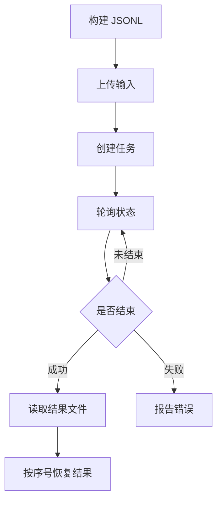

# 第 15 章下篇　真正接入模型：后台批任务

上一节的线程池像让多名工作人员同时打电话，每个电话都要等回信。现在假设有两万条历史短信，不急着立即得到结果。我们可以把任务装订成一份清单，交给对方的后台队列，稍后回来取整批答卷。

## 15.10 三种批量的区别

第 8 章的 batch_length 是本地每次交给 infer 的块数；第 15 章上篇的 max_workers 是本地并发请求数量；服务器的 Batch API 则是创建远端任务、轮询状态、下载文件。它们不是同一个设置。默认批模式需要达到阈值才触发，否则仍走即时请求。

服务可能打乱答卷顺序。最简单的解决方法是每条请求自带编号。

```python
import json

prompts = ["Pickup 3821", "Pickup 9246"]
input_lines = [json.dumps({"id": i, "prompt": p}) for i,p in enumerate(prompts)]
print("\n".join(input_lines))
replies = [{"id": 1, "output": "9246"}, {"id": 0, "output": "3821"}]
indexed = {r["id"]: r["output"] for r in replies}
assert [indexed[i] for i in range(len(prompts))] == ["3821", "9246"]
```

一行 JSON 表示一个请求，文件名常用 JSONL。相比一个大 JSON 数组，它可以逐行生成和读取。请求编号不是取件码，而是这批任务中的原始序号。



## 15.11 OpenAI Batch 的配置对象

源码出处：[langextract/providers/openai_batch.py:51–128](https://github.com/google/langextract/blob/b3499195e5ee711d3bb7da5178ba40456046f5f3/langextract/providers/openai_batch.py#L51-L128)。

````python
@dataclasses.dataclass(slots=True, frozen=True)
class BatchConfig:
  """Define and validate OpenAI Batch API configuration.

  OpenAI Batch intentionally omits Gemini's GCS caching, retention_days, and
  ignore_item_errors controls. OpenAI stores batch files through its Files API,
  and per-item errors fail the call so callers do not silently consume partial
  results.

  Attributes:
    enabled: Whether batch mode is enabled.
    threshold: Minimum prompts to trigger batch processing.
    completion_window: OpenAI completion window string. The Batch API currently
      supports only "24h".
    poll_interval: Seconds between status checks.
    timeout: Maximum seconds to wait for completion.
    max_requests_per_job: Safety cap on the number of requests per batch job.
      This mirrors Gemini's max_prompts_per_job concept, but uses OpenAI's
      request-keyed terminology.
    metadata: Optional metadata dict attached to the batch job.
    on_job_create: Optional hook invoked with the created job object.
  """

  enabled: bool = False
  threshold: int = _DEFAULT_THRESHOLD
  completion_window: str = _DEFAULT_COMPLETION_WINDOW
  poll_interval: int = _DEFAULT_POLL_INTERVAL
  timeout: int = _DEFAULT_TIMEOUT
  max_requests_per_job: int = _DEFAULT_MAX_REQUESTS_PER_JOB
  metadata: Mapping[str, Any] | None = None
  on_job_create: Callable[[Any], None] | None = None

  def __post_init__(self):
    validations = [
        (self.threshold >= 1, 'batch.threshold must be >= 1'),
        (self.poll_interval > 0, 'batch.poll_interval must be > 0'),
        (self.timeout > 0, 'batch.timeout must be > 0'),
        (
            self.max_requests_per_job > 0,
            'batch.max_requests_per_job must be > 0',
        ),
    ]
    for is_valid, msg in validations:
      if not is_valid:
        raise ValueError(msg)

    if self.completion_window != _DEFAULT_COMPLETION_WINDOW:
      raise ValueError(
          f'batch.completion_window must be {_DEFAULT_COMPLETION_WINDOW!r}'
      )

  @classmethod
  def from_dict(
      cls, d: Mapping[str, Any] | BatchConfig | bool | None
  ) -> BatchConfig:
    """Create BatchConfig from user-provided batch configuration."""
    if isinstance(d, cls):
      return d
    if isinstance(d, bool):
      return cls(enabled=d)
    if d is None:
      return cls(enabled=False)
    if not isinstance(d, Mapping):
      raise TypeError('batch must be a mapping, BatchConfig, bool, or None')
    if not d:
      return cls(enabled=False)

    valid_keys = {field.name for field in dataclasses.fields(cls)}
    filtered = {key: value for key, value in d.items() if key in valid_keys}
    filtered.setdefault('enabled', True)

    unknown = sorted(set(d.keys()) - valid_keys)
    if unknown:
      logging.warning(
          'Ignoring unknown OpenAI batch config keys: %s', ', '.join(unknown)
      )

    return cls(**filtered)
````

BatchConfig 是冻结、有 slots 的配置对象，表示是否启用、阈值、完成窗口、轮询间隔、超时、单任务最大请求数、可选元数据和创建任务回调。

__post_init__ 验证正数条件、threshold 至少 1，完成窗口必须是项目支持的 24h 字符串。from_dict 兼容已有配置、布尔值、None、空映射和一般映射；非空映射默认启用，按 dataclasses.fields 过滤未知键并警告，最后调用构造方法统一校验。

## 15.12 如何统一响应形式

源码出处：[langextract/providers/openai_batch.py:131–132](https://github.com/google/langextract/blob/b3499195e5ee711d3bb7da5178ba40456046f5f3/langextract/providers/openai_batch.py#L131-L132)。

````python
def _custom_id(idx: int) -> str:
  return f'idx-{idx:06d}'
````
源码出处：[langextract/providers/openai_batch.py:156–162](https://github.com/google/langextract/blob/b3499195e5ee711d3bb7da5178ba40456046f5f3/langextract/providers/openai_batch.py#L156-L162)。

````python
def _index_from_custom_id(custom_id: Any) -> int | None:
  if not isinstance(custom_id, str) or not custom_id.startswith('idx-'):
    return None
  try:
    return int(custom_id.split('-', 1)[1])
  except ValueError:
    return None
````

_custom_id 将索引格式化为带至少六位数字的 idx- 前缀字符串；_index_from_custom_id 检查字符串前缀并尝试转整数，非法返回 None。前者写入请求，后者读取答卷。

源码出处：[langextract/providers/openai_batch.py:135–138](https://github.com/google/langextract/blob/b3499195e5ee711d3bb7da5178ba40456046f5f3/langextract/providers/openai_batch.py#L135-L138)。

````python
def _field(obj: Any, name: str) -> Any:
  if isinstance(obj, Mapping):
    return obj.get(name)
  return getattr(obj, name, None)
````
源码出处：[langextract/providers/openai_batch.py:152–153](https://github.com/google/langextract/blob/b3499195e5ee711d3bb7da5178ba40456046f5f3/langextract/providers/openai_batch.py#L152-L153)。

````python
def _job_errors(job: Any) -> Any:
  return _field(job, 'errors') or _field(job, 'error')
````

SDK 可能给属性对象，测试替身可能给字典。_field 根据 Mapping 或对象属性统一取值，缺失返回 None；_job_errors 优先读取 errors，否则读取 error。

源码出处：[langextract/providers/openai_batch.py:141–149](https://github.com/google/langextract/blob/b3499195e5ee711d3bb7da5178ba40456046f5f3/langextract/providers/openai_batch.py#L141-L149)。

````python
def _format_error(value: Any) -> str:
  if value is None:
    return ''
  if isinstance(value, str):
    return value
  try:
    return json.dumps(value, default=str, sort_keys=True)
  except TypeError:
    return str(value)
````

_format_error 将 None 转为空串，字符串直接保留，其他值尝试按排序键 JSON 序列化（不支持值转 str），TypeError 时直接 str。目的是生成可读诊断，而不是业务输出。

源码出处：[langextract/providers/openai_batch.py:165–205](https://github.com/google/langextract/blob/b3499195e5ee711d3bb7da5178ba40456046f5f3/langextract/providers/openai_batch.py#L165-L205)。

````python
def _extract_text_from_response_body(
    body: Mapping[str, Any], custom_id: str | None = None
) -> str:
  choices = body.get('choices')
  if not choices:
    raise exceptions.InferenceRuntimeError(
        "OpenAI batch response body missing 'choices'", provider='OpenAI'
    )

  try:
    choice = choices[0]
    message = choice.get('message') or {}
    finish_reason = choice.get('finish_reason')
  except (AttributeError, IndexError, TypeError) as e:
    raise exceptions.InferenceRuntimeError(
        "OpenAI batch response body has invalid 'choices'",
        original=e,
        provider='OpenAI',
    ) from e

  content = message.get('content')
  if content is None:
    refusal = message.get('refusal')
    if refusal:
      raise exceptions.InferenceRuntimeError(
          f'OpenAI batch response refusal: {refusal}',
          provider='OpenAI',
      )
    raise exceptions.InferenceRuntimeError(
        "OpenAI batch response body missing 'message.content'",
        provider='OpenAI',
    )
  if content and finish_reason == 'length':
    logging.warning(
        'OpenAI Batch API: Item %r stopped at the output token limit'
        ' (finish_reason=length), so its response is likely incomplete and'
        ' may fail to parse. Consider raising max_output_tokens or lowering'
        ' max_char_buffer.',
        custom_id or '',
    )
  return content
````

从响应 body.choices 的第一项取 message、finish_reason；没有 choices 或结构非法报运行时错误。content=None 时区分 refusal 和缺内容；非空 content 且 length 结束时警告可能截断。注意与即时响应转换不同，此处只在 content 为 None 时检查 refusal。

源码出处：[langextract/providers/openai_batch.py:208–238](https://github.com/google/langextract/blob/b3499195e5ee711d3bb7da5178ba40456046f5f3/langextract/providers/openai_batch.py#L208-L238)。

````python
def _content_to_text(content: Any) -> str:
  """Best-effort conversion of OpenAI SDK file content responses to text."""
  if content is None:
    return ''
  if isinstance(content, str):
    return content
  if isinstance(content, bytes):
    return content.decode('utf-8')

  text = getattr(content, 'text', None)
  if isinstance(text, str):
    return text

  read = getattr(content, 'read', None)
  if callable(read):
    data = read()
    if isinstance(data, bytes):
      return data.decode('utf-8')
    if isinstance(data, str):
      return data
    raise exceptions.InferenceRuntimeError(
        'OpenAI Batch API output returned unsupported read() payload type '
        f'{type(data).__name__}',
        provider='OpenAI',
    )

  raise exceptions.InferenceRuntimeError(
      'OpenAI Batch API output returned unsupported content type '
      f'{type(content).__name__}',
      provider='OpenAI',
  )
````

下载文件返回值也可能不同。_content_to_text 依次处理 None、str、bytes（UTF-8）、对象 text 属性、read() 返回的 str/bytes；其他类型抛推理异常。适配层将各种文件接口归一为文本，便于下一步逐行解析。

## 15.13 下载答卷不是一定成功

源码出处：[langextract/providers/openai_batch.py:241–245](https://github.com/google/langextract/blob/b3499195e5ee711d3bb7da5178ba40456046f5f3/langextract/providers/openai_batch.py#L241-L245)。

````python
def _error_status_code(error: Exception) -> int | None:
  response = getattr(error, 'response', None)
  return getattr(error, 'status_code', None) or getattr(
      response, 'status_code', None
  )
````
源码出处：[langextract/providers/openai_batch.py:248–256](https://github.com/google/langextract/blob/b3499195e5ee711d3bb7da5178ba40456046f5f3/langextract/providers/openai_batch.py#L248-L256)。

````python
def _download_error_message(error: Exception) -> str:
  """Return an actionable message for Batch output download failures."""
  message = f'OpenAI Batch API output download failed: {error}'
  if _error_status_code(error) == 403:
    message += (
        '. Ensure the OpenAI API key has Files Read permission; Batch output '
        'is downloaded through the Files API.'
    )
  return message
````

_error_status_code 从异常本身或其 response 取状态码。_download_error_message 拼接下载失败信息，403 时补充 Files Read 权限提示，要求调用者检查合法授权。

源码出处：[langextract/providers/openai_batch.py:259–280](https://github.com/google/langextract/blob/b3499195e5ee711d3bb7da5178ba40456046f5f3/langextract/providers/openai_batch.py#L259-L280)。

````python
def _load_output_file(client: Any, file_id: str, cfg: BatchConfig) -> str:
  last_error: Exception | None = None
  for attempt in range(_OUTPUT_DOWNLOAD_MAX_ATTEMPTS):
    try:
      content = client.files.content(file_id)
      return _content_to_text(content)
    except Exception as e:
      last_error = e
      should_retry = (
          _error_status_code(e) in _OUTPUT_DOWNLOAD_RETRY_STATUSES
          and attempt < _OUTPUT_DOWNLOAD_MAX_ATTEMPTS - 1
      )
      if not should_retry:
        break
      time.sleep(min(cfg.poll_interval, 5))

  assert last_error is not None
  raise exceptions.InferenceRuntimeError(
      _download_error_message(last_error),
      original=last_error,
      provider='OpenAI',
  ) from last_error
````

_load_output_file 调用 files.content 并转换文本；仅对配置中的暂时状态（源码为 403）进行有限次等待重试，最终仍失败则包装原异常，不会跳过权限检查。

源码出处：[langextract/providers/openai_batch.py:283–295](https://github.com/google/langextract/blob/b3499195e5ee711d3bb7da5178ba40456046f5f3/langextract/providers/openai_batch.py#L283-L295)。

````python
def _delete_uploaded_input_file(client: Any, input_file_id: str) -> None:
  delete_file = getattr(client.files, 'delete', None)
  if not callable(delete_file):
    return
  try:
    delete_file(input_file_id)
  except Exception as e:
    logging.warning(
        'Failed to delete OpenAI Batch API input file %s after job create '
        'failure: %s',
        input_file_id,
        e,
    )
````

如果上传输入后创建任务失败，_delete_uploaded_input_file 尝试清理刚上传的输入文件。有 delete 方法才调用，清理失败只警告以保留原错误。它不是任意文件删除接口。

## 15.14 一张清单有一条失败怎么办

源码出处：[langextract/providers/openai_batch.py:298–311](https://github.com/google/langextract/blob/b3499195e5ee711d3bb7da5178ba40456046f5f3/langextract/providers/openai_batch.py#L298-L311)。

````python
def _item_error_text(
    custom_id: str,
    item_error: Any,
    status_code: Any,
    body_error: Any,
) -> str:
  parts = []
  if status_code is not None:
    parts.append(f'status_code={status_code}')
  if item_error:
    parts.append(f'error={_format_error(item_error)}')
  if body_error:
    parts.append(f'body_error={_format_error(body_error)}')
  return f'{custom_id}: ' + ', '.join(parts)
````

_item_error_text 将编号、HTTP 状态码、item_error、body_error 中存在的部分拼成一条诊断，不改变错误对象。

源码出处：[langextract/providers/openai_batch.py:314–358](https://github.com/google/langextract/blob/b3499195e5ee711d3bb7da5178ba40456046f5f3/langextract/providers/openai_batch.py#L314-L358)。

````python
def _collect_outputs_from_jsonl(
    text: str,
    outputs_by_idx: dict[int, str],
    errors: list[str],
) -> None:
  for raw_line in text.splitlines():
    line = raw_line.strip()
    if not line:
      continue
    try:
      obj = json.loads(line)
    except Exception as e:
      raise exceptions.InferenceRuntimeError(
          f'OpenAI Batch API output JSONL parse error: {e}',
          original=e,
          provider='OpenAI',
      ) from e

    cid = obj.get('custom_id')
    idx = _index_from_custom_id(cid)
    if idx is None:
      logging.warning(
          'Skipping OpenAI batch output with unexpected custom_id: %r', cid
      )
      continue

    response = obj.get('response') or {}
    body = response.get('body') or {}
    status_code = response.get('status_code')
    item_error = obj.get('error')
    body_error = body.get('error') if isinstance(body, Mapping) else None
    if (
        item_error
        or body_error
        or (isinstance(status_code, int) and status_code >= 400)
    ):
      errors.append(_item_error_text(cid, item_error, status_code, body_error))
      continue

    try:
      outputs_by_idx[idx] = _extract_text_from_response_body(
          body, custom_id=cid
      )
    except exceptions.InferenceRuntimeError as e:
      errors.append(f'{cid}: {e}')
````

逐行 strip 并跳过空行，解析 JSON，坏 JSON 直接抛运行异常。读取 custom_id 得原索引；不认识的 ID 警告并跳过。检查响应状态码、行级 error 和 body.error，错误加入 errors；成功则调用文本转换，将结果存入 outputs_by_idx。转换失败同样记录为编号对应错误。此函数通过传入字典和列表累积数据，供读取输出文件与错误文件时共同使用。

## 15.15 OpenAI 整个后台任务流程

源码出处：[langextract/providers/openai_batch.py:425–583](https://github.com/google/langextract/blob/b3499195e5ee711d3bb7da5178ba40456046f5f3/langextract/providers/openai_batch.py#L425-L583)。

````python
def _infer_batch_one_job(
    *,
    client: Any,
    model_id: str,
    prompts: Sequence[str],
    cfg: BatchConfig,
    request_builder: Callable[[str], Mapping[str, Any]],
    endpoint: str,
    base_index: int,
) -> list[str]:
  lines: list[str] = []
  for i, prompt in enumerate(prompts):
    idx = base_index + i
    body = dict(request_builder(prompt))
    body.setdefault('model', model_id)

    req = {
        'custom_id': _custom_id(idx),
        'method': 'POST',
        'url': endpoint,
        'body': body,
    }
    lines.append(json.dumps(req, ensure_ascii=False))

  jsonl = '\n'.join(lines) + '\n'

  # Use an in-memory buffer with a name attribute for broad compatibility.
  buf = io.BytesIO(jsonl.encode('utf-8'))
  buf.name = 'langextract_openai_batch_input.jsonl'  # type: ignore[attr-defined]

  try:
    input_file = client.files.create(file=buf, purpose='batch')
    input_file_id = _field(input_file, 'id')
  except Exception as e:
    raise exceptions.InferenceRuntimeError(
        f'OpenAI Batch API input file upload failed: {e}',
        original=e,
        provider='OpenAI',
    ) from e

  if not input_file_id:
    raise exceptions.InferenceRuntimeError(
        'OpenAI Batch API input file upload returned no file id',
        provider='OpenAI',
    )

  try:
    create_kwargs: dict[str, Any] = {
        'input_file_id': input_file_id,
        'endpoint': endpoint,
        'completion_window': cfg.completion_window,
    }
    if cfg.metadata:
      create_kwargs['metadata'] = dict(cfg.metadata)

    job = client.batches.create(**create_kwargs)
    if cfg.on_job_create:
      cfg.on_job_create(job)
    batch_id = _field(job, 'id')
  except Exception as e:
    _delete_uploaded_input_file(client, input_file_id)
    raise exceptions.InferenceRuntimeError(
        f'OpenAI Batch API job create failed: {e}',
        original=e,
        provider='OpenAI',
    ) from e

  if not batch_id:
    raise exceptions.InferenceRuntimeError(
        'OpenAI Batch API job create returned no batch id',
        provider='OpenAI',
    )

  logging.info(
      'Created OpenAI Batch API job %s for %d prompts', batch_id, len(prompts)
  )

  start = time.time()
  last_status = None
  while True:
    if time.time() - start > cfg.timeout:
      cancel = getattr(client.batches, 'cancel', None)
      if callable(cancel):
        try:
          cancel(batch_id)
        except Exception as e:
          logging.warning(
              'Failed to cancel timed-out OpenAI batch job %s: %s', batch_id, e
          )
      raise exceptions.InferenceRuntimeError(
          f'OpenAI Batch API job timed out after {cfg.timeout}s'
          f' (last_status={last_status})',
          provider='OpenAI',
      )

    try:
      job = client.batches.retrieve(batch_id)
    except Exception as e:
      raise exceptions.InferenceRuntimeError(
          f'OpenAI Batch API job retrieve failed: {e}',
          original=e,
          provider='OpenAI',
      ) from e

    status = _field(job, 'status')
    if status != last_status:
      logging.info('OpenAI Batch API job %s status: %s', batch_id, status)
      last_status = status

    if status in _TERMINAL_STATUSES:
      break

    time.sleep(cfg.poll_interval)

  if status != 'completed':
    err = _job_errors(job)
    raise exceptions.InferenceRuntimeError(
        f'OpenAI Batch API job did not complete (status={status}, error={err})',
        provider='OpenAI',
    )

  output_file_id = _field(job, 'output_file_id') or _field(job, 'output_file')
  error_file_id = _field(job, 'error_file_id') or _field(job, 'error_file')
  if not output_file_id and not error_file_id:
    raise exceptions.InferenceRuntimeError(
        'OpenAI Batch API job completed but has no output_file_id or '
        'error_file_id',
        provider='OpenAI',
    )

  outputs_by_idx: dict[int, str] = {}
  errors: list[str] = []

  if output_file_id:
    _collect_outputs_from_jsonl(
        _load_output_file(client, output_file_id, cfg), outputs_by_idx, errors
    )

  if error_file_id:
    _collect_outputs_from_jsonl(
        _load_output_file(client, error_file_id, cfg), outputs_by_idx, errors
    )

  if errors:
    raise exceptions.InferenceRuntimeError(
        'OpenAI Batch API per-item errors: ' + '; '.join(errors),
        provider='OpenAI',
    )

  chunk_outputs: list[str] = []
  for i in range(base_index, base_index + len(prompts)):
    if i not in outputs_by_idx:
      raise exceptions.InferenceRuntimeError(
          f'OpenAI Batch API missing output for custom_id={_custom_id(i)}',
          provider='OpenAI',
      )
    chunk_outputs.append(outputs_by_idx[i])

  return chunk_outputs
````

_infer_batch_one_job 逐个 prompt 调用传入 request_builder，补缺省模型名，为每行添加全局编号、方法、目标 API 和请求体。JSONL 编码为 BytesIO，带 name 供 SDK 处理，上传得到文件 ID。

随后创建 batch，带 completion_window、可选 metadata，调用 on_job_create 回调并取得任务 ID。创建异常时尽力清理输入，再抛带上下文错误。轮询阶段反复 retrieve，状态变化记日志；超时尽力 cancel，再报错。失败、过期、取消等终态不返回正常结果。

成功任务必须有输出或错误文件 ID。分别下载并解析，累计 errors 后只要非空就整体失败。最后按 base_index 到 base_index+len(prompts) 恢复文本列表，任何编号缺失都报错。这样不能把不完整批次误认为完整答卷。

源码出处：[langextract/providers/openai_batch.py:361–422](https://github.com/google/langextract/blob/b3499195e5ee711d3bb7da5178ba40456046f5f3/langextract/providers/openai_batch.py#L361-L422)。

````python
def infer_batch(
    *,
    client: Any,
    model_id: str,
    prompts: Sequence[str],
    cfg: BatchConfig,
    request_builder: Callable[[str], Mapping[str, Any]],
    endpoint: str = _DEFAULT_ENDPOINT,
    batch_size: int | None = None,
) -> list[str]:
  """Execute batch inference on multiple prompts using OpenAI Batch API.

  Args:
    client: OpenAI client instance (or compatible fake for testing).
    model_id: OpenAI model id.
    prompts: Prompt strings.
    cfg: Batch configuration.
    request_builder: Callable that produces the request body for one prompt.
    endpoint: The OpenAI endpoint string for the batch (default chat completions).
    batch_size: Optional limit that splits prompts into sequential Batch API
      jobs of at most this many requests.

  Returns:
    List of output texts aligned with prompts.

  Raises:
    InferenceRuntimeError: On job failure, timeout, output download failure, or
      any per-item errors. Per-item errors fail the call rather than returning
      partial results.
  """
  if not prompts:
    return []

  if not cfg.enabled:
    raise exceptions.InferenceConfigError(
        'OpenAI batch mode is not enabled (cfg.enabled=False)'
    )

  if batch_size is not None and batch_size <= 0:
    raise exceptions.InferenceConfigError('batch_size must be > 0')

  per_job_limit = cfg.max_requests_per_job
  if batch_size is not None:
    per_job_limit = min(per_job_limit, batch_size)

  outputs: list[str] = [''] * len(prompts)

  # OpenAI caps each Batch job; callers may also use batch_size to throttle.
  for offset in range(0, len(prompts), per_job_limit):
    chunk = list(prompts[offset : offset + per_job_limit])
    chunk_outputs = _infer_batch_one_job(
        client=client,
        model_id=model_id,
        prompts=chunk,
        cfg=cfg,
        request_builder=request_builder,
        endpoint=endpoint,
        base_index=offset,
    )
    outputs[offset : offset + len(chunk_outputs)] = chunk_outputs

  return outputs
````

这个入口处理空输入、检查启用配置和 batch_size；单任务限制取 max_requests_per_job 和可选 batch_size 的较小者。将提示按该长度分段，顺序调用 _infer_batch_one_job 并传 base_index=offset，结果写回预分配列表。注意任务拆分是在本地批次的内部再分一次。

## 15.16 Gemini Batch：文件存储与远端任务分离

与 OpenAI Files 不同，这份固定源码的 Gemini 批任务路径限定 Vertex AI，以 GCS 文件保存输入和输出。它还有可选云端缓存。先理解请求的构造，然后看保存、提交、读回三个层次。

源码出处：[langextract/providers/gemini_batch.py:97–169](https://github.com/google/langextract/blob/b3499195e5ee711d3bb7da5178ba40456046f5f3/langextract/providers/gemini_batch.py#L97-L169)。

````python
@dataclasses.dataclass(slots=True, frozen=True)
class BatchConfig:
  """Define and validate Gemini Batch API configuration.

  Attributes:
    enabled: Whether batch mode is enabled.
    threshold: Minimum prompts to trigger batch processing.
    poll_interval: Seconds between job status checks.
    timeout: Maximum seconds to wait for job completion.
    max_prompts_per_job: Max prompts allowed in one batch job.
    ignore_item_errors: If True, continue on per-item errors.
    enable_caching: If True, cache inference results in GCS. Strict runs
      recheck empty entries, which may represent previously ignored failures.
    retention_days: Days to keep GCS data (default 30). None for permanent.
  """

  enabled: bool = False
  threshold: int = 50
  poll_interval: int = 30
  timeout: int = 3600
  max_prompts_per_job: int = 20000
  ignore_item_errors: bool = False
  enable_caching: bool | None = _UNSET  # type: ignore
  retention_days: int | None = _UNSET  # type: ignore
  on_job_create: Callable[[Any], None] | None = None

  def __post_init__(self):
    """Validate numeric knobs early."""

    validations = [
        (self.threshold >= 1, "batch.threshold must be >= 1"),
        (self.poll_interval > 0, "batch.poll_interval must be > 0"),
        (self.timeout > 0, "batch.timeout must be > 0"),
        (self.timeout > 0, "batch.timeout must be > 0"),
        (self.max_prompts_per_job > 0, "batch.max_prompts_per_job must be > 0"),
    ]
    for is_valid, error_msg in validations:
      if not is_valid:
        raise ValueError(error_msg)

    if self.enabled:
      if self.enable_caching is _UNSET:
        raise ValueError(
            "batch.enable_caching must be explicitly set when batch is enabled"
        )
      if self.retention_days is _UNSET:
        raise ValueError(
            "batch.retention_days must be explicitly set when batch is enabled"
            " (use None for permanent)"
        )
      if self.retention_days is not None and self.retention_days <= 0:
        raise ValueError(
            "batch.retention_days must be > 0 or None (for permanent). "
            "0 (immediate delete) is not allowed."
        )

  @classmethod
  def from_dict(cls, d: dict | None) -> BatchConfig:
    """Create BatchConfig from dictionary, using defaults for missing keys."""
    if d is None:
      return cls()
    valid_keys = {f.name for f in dataclasses.fields(cls)}
    filtered_dict = {k: v for k, v in d.items() if k in valid_keys}

    unknown = sorted(set(d.keys()) - valid_keys)
    if unknown:
      logging.warning(
          "Ignoring unknown batch config keys: %s", ", ".join(unknown)
      )
    cfg = cls(**filtered_dict)
    if cfg.on_job_create is None:
      object.__setattr__(cfg, "on_job_create", _default_job_create_callback)
    return cfg
````

Gemini 的 BatchConfig 同样冻结，并有 enabled、threshold、poll_interval、timeout、max_prompts_per_job；另外具有 ignore_item_errors、enable_caching、retention_days。__post_init__ 校验长度和时间数值；启用时要求明确配置缓存与保留天数，None 代表永久保留，非正值不允许。_UNSET 哨兵区分没填与填了 None。

from_dict(None) 直接默认配置；字典路径根据 dataclass 字段过滤未知项、记录警告并构造，若无创建回调，用 object.__setattr__ 安装默认回调。它与 OpenAI 的布尔值便利路径并不完全相同。

源码出处：[langextract/providers/gemini_batch.py:183–203](https://github.com/google/langextract/blob/b3499195e5ee711d3bb7da5178ba40456046f5f3/langextract/providers/gemini_batch.py#L183-L203)。

````python
def _default_job_create_callback(job: Any) -> None:
  """Default callback to log batch job details."""
  logging.info("Batch job created successfully: %s", job.name)
  logging.info("Job State: %s", job.state)
  # Extract project and job ID for console URL
  try:
    # job.name format: projects/{project}/locations/{location}/batchPredictionJobs/{job_id}
    parts = job.name.split("/")
    if len(parts) >= 6:
      job_id = parts[-1]
      location = parts[3]
      project = parts[1]
      logging.info(
          "Job Console URL:"
          " https://console.cloud.google.com/vertex-ai/locations/%s/batch-predictions/%s?project=%s",
          location,
          job_id,
          project,
      )
  except Exception:
    pass
````

默认回调记任务名称及状态，并尝试由标准资源路径切出项目、区域和任务 ID，给日志提供控制台定位地址。路径解析失败不影响核心处理。

源码出处：[langextract/providers/gemini_batch.py:84–94](https://github.com/google/langextract/blob/b3499195e5ee711d3bb7da5178ba40456046f5f3/langextract/providers/gemini_batch.py#L84-L94)。

````python
def _json_default(obj: Any) -> Any:
  """Serialize non-JSON-native objects used in provider configurations."""
  if isinstance(obj, pydantic.BaseModel):
    return obj.model_dump(mode="json", by_alias=True, exclude_none=True)
  if dataclasses.is_dataclass(obj):
    return dataclasses.asdict(obj)
  if isinstance(obj, enum.Enum):
    return obj.value
  raise TypeError(
      f"Object of type {type(obj).__name__} is not JSON serializable"
  )
````

JSON 默认编码器处理 Pydantic BaseModel（按别名输出 JSON 模式，排除 None）、dataclass（asdict）和 Enum（value），其他类型抛 TypeError。这样 SDK 配置对象可以进入普通 JSONL。

源码出处：[langextract/providers/gemini_batch.py:206–209](https://github.com/google/langextract/blob/b3499195e5ee711d3bb7da5178ba40456046f5f3/langextract/providers/gemini_batch.py#L206-L209)。

````python
def _snake_to_camel(key: str) -> str:
  """Convert snake_case to camelCase for REST API compatibility."""
  parts = key.split("_")
  return parts[0] + "".join(p.title() for p in parts[1:])
````

按下划线拆分键，保留第一段，将后续段首字母变大写再拼合。Python 的 max_output_tokens 变成 REST 的 maxOutputTokens；不是对嵌套整个对象进行转换。

源码出处：[langextract/providers/gemini_batch.py:289–322](https://github.com/google/langextract/blob/b3499195e5ee711d3bb7da5178ba40456046f5f3/langextract/providers/gemini_batch.py#L289-L322)。

````python
def _encode_batch_tools(tools: Sequence[Any]) -> list[Any]:
  """Encode tools in a form that Vertex AI batch can import.

  Vertex AI batch rejects input files that contain empty JSON objects. A
  default google_search tool is therefore sent with an empty domain exclusion
  list, which has the same meaning. Other tools with an empty configuration
  have no equivalent form, so they are rejected before anything is uploaded.

  Args:
    tools: Tools as dictionaries or google.genai types.

  Returns:
    JSON-compatible tool dictionaries. The input is not modified.

  Raises:
    InferenceConfigError: If a tool configuration is empty and has no
      equivalent form that Vertex AI batch can import.
  """
  encoded = json.loads(json.dumps(list(tools), default=_json_default))
  for index, tool in enumerate(encoded):
    if not isinstance(tool, dict):
      continue
    for key, value in list(tool.items()):
      if value != {}:
        continue
      if key in _GOOGLE_SEARCH_EMPTY_FIELDS:
        tool[key] = {_GOOGLE_SEARCH_EMPTY_FIELDS[key]: []}
      else:
        raise exceptions.InferenceConfigError(
            f"Tool configuration tools[{index}].{key} is empty, and Vertex AI"
            " batch cannot import empty objects. Set an option on this tool"
            " if it has one, or disable batch mode to use it."
        )
  return encoded
````

将工具配置序列经 JSON 编码再解码得到独立的 JSON 兼容列表。Vertex 批导入不能接受空对象，源码为已知等价空配置提供兼容表示，其他空工具配置直接报配置错误。这只是在适配数据格式，并不执行任何工具。

源码出处：[langextract/providers/gemini_batch.py:325–397](https://github.com/google/langextract/blob/b3499195e5ee711d3bb7da5178ba40456046f5f3/langextract/providers/gemini_batch.py#L325-L397)。

````python
def _build_request(
    prompt: str,
    schema_config: dict | None,
    gen_config: dict | None,
    system_instruction: str | None = None,
    safety_settings: Sequence[Any] | None = None,
    tools: Sequence[Any] | None = None,
) -> dict:
  """Build a batch request in REST format for file-based submission.

  Constructs a properly formatted request dictionary for batch processing.
  Per the Gemini Batch API documentation, each request in the JSONL file
  can include its own generationConfig with schema and generation parameters,
  as well as top-level systemInstruction, safetySettings, and tools.

  Args:
    prompt: The text prompt to send to the model.
    schema_config: Optional provider schema config for structured output, as
        produced by GeminiSchema.to_provider_config(). Supports
        response_json_schema (JSON Schema) and response_schema
        (OpenAPI-style) sources.
    gen_config: Optional generation configuration parameters.
    system_instruction: Optional system instruction text.
    safety_settings: Optional safety settings sequence.
    tools: Optional tools sequence (e.g., google_search). Tools are encoded
        so that Vertex AI batch can import them; see _encode_batch_tools.

  Returns:
    A dictionary formatted for REST API file-based submission, containing:
      * contents: The prompt content.
      * systemInstruction: Optional system instructions.
      * safetySettings: Optional safety settings.
      * tools: Optional tools.
      * generationConfig: Optional generation configuration and schema.

  Raises:
    InferenceConfigError: If a tool cannot be sent through Vertex AI batch.
  """
  request: dict[str, Any] = {
      "contents": [{"role": "user", "parts": [{"text": prompt}]}]
  }

  effective_gen_config = dict(gen_config) if gen_config else {}
  gen_config_tools = effective_gen_config.pop("tools", None)
  effective_tools = tools if tools is not None else gen_config_tools

  if system_instruction:
    request["systemInstruction"] = {"parts": [{"text": system_instruction}]}

  if safety_settings:
    request["safetySettings"] = safety_settings

  if effective_tools:
    request["tools"] = _encode_batch_tools(effective_tools)

  if schema_config or effective_gen_config:
    generation_config = {}
    if schema_config:
      json_schema = schema_config.get("response_json_schema")
      response_schema = schema_config.get("response_schema")
      if json_schema is not None:
        generation_config["responseJsonSchema"] = json_schema
      elif response_schema is not None:
        generation_config["responseSchema"] = response_schema
      generation_config["responseMimeType"] = schema_config.get(
          "response_mime_type", _MIME_TYPE_JSON
      )
    if effective_gen_config:
      for k, v in effective_gen_config.items():
        generation_config[_snake_to_camel(k)] = v
    request["generationConfig"] = generation_config

  return request
````

_build_request 构建 contents 的 user/parts/text 结构；复制 gen_config 并取出其中 tools，显式 tools 优先。按需加入系统指令、安全设置和编码后的工具。generationConfig 中根据 schema 来源设置 responseJsonSchema 或 responseSchema 以及 MIME 类型，其余生成键转为 camelCase 后合并。

这个函数只准备数据，便于不用 SDK 或云账号测试。与 OpenAI request_builder 概念类似，但字段结构不同。

## 15.17 文件放在哪里？

源码出处：[langextract/providers/gemini_batch.py:212–221](https://github.com/google/langextract/blob/b3499195e5ee711d3bb7da5178ba40456046f5f3/langextract/providers/gemini_batch.py#L212-L221)。

````python
def _is_vertexai_client(client) -> bool:
  """Check if client is configured for Vertex AI with explicit identity check.

  Args:
    client: The genai.Client instance to check.

  Returns:
    True if client.vertexai is explicitly True, False otherwise.
  """
  return getattr(client, "vertexai", False) is True
````

通过 client.vertexai is True 精确判断配置，避免普通真值对象被误认为 Vertex 客户端。

源码出处：[langextract/providers/gemini_batch.py:224–241](https://github.com/google/langextract/blob/b3499195e5ee711d3bb7da5178ba40456046f5f3/langextract/providers/gemini_batch.py#L224-L241)。

````python
def _get_project_location(
    client: genai.Client,
    project: str | None = None,
    location: str | None = None,
) -> tuple[str | None, str]:
  """Extract project and location from client or arguments."""
  if project:
    proj = project
  else:
    # Try to get from client (if available in future versions) or env.
    proj = getattr(client, "project", None) or os.getenv("GOOGLE_CLOUD_PROJECT")

  if location:
    loc = location
  else:
    loc = getattr(client, "location", None) or _DEFAULT_LOCATION

  return proj, loc
````

显式 project/location 优先，其次客户端属性，项目还能取环境默认，区域有源码默认值。集中处理配置发现，提交与缓存可共享规则。

源码出处：[langextract/providers/gemini_batch.py:244–247](https://github.com/google/langextract/blob/b3499195e5ee711d3bb7da5178ba40456046f5f3/langextract/providers/gemini_batch.py#L244-L247)。

````python
def _get_bucket_name(project: str | None, location: str) -> str:
  """Generate consistent GCS bucket name for batch operations."""
  base = f"langextract-{project}-{location}-batch".lower()
  return re.sub(r"[^a-z0-9._-]", "-", base)
````

使用项目、区域生成确定性小写桶名，把不允许字符替换为连字符。确定性让同一配置可找到同一存储位置；不是访问权限检查。

源码出处：[langextract/providers/gemini_batch.py:250–286](https://github.com/google/langextract/blob/b3499195e5ee711d3bb7da5178ba40456046f5f3/langextract/providers/gemini_batch.py#L250-L286)。

````python
def _ensure_bucket_lifecycle(
    bucket: storage.Bucket, retention_days: int | None
) -> None:
  """Ensure bucket has a lifecycle rule to delete objects after retention_days.

  This is a best-effort optimization to reduce storage costs. It checks if
  a rule with the exact age exists, and if not, adds it. It does NOT remove
  existing rules.

  Args:
    bucket: The GCS bucket to configure.
    retention_days: Number of days to keep objects. If None, no rule is added.
  """
  if retention_days is None or retention_days <= 0:
    return

  # Check if rule already exists
  for rule in bucket.lifecycle_rules:
    if (
        rule.get("action", {}).get("type") == "Delete"
        and rule.get("condition", {}).get("age") == retention_days
    ):
      return

  # Add new rule
  bucket.add_lifecycle_delete_rule(age=retention_days)
  try:
    bucket.patch()
    logging.info(
        "Added lifecycle rule to bucket %s: delete after %d days",
        bucket.name,
        retention_days,
    )
  except Exception as e:
    logging.warning(
        "Failed to update lifecycle rule for bucket %s: %s", bucket.name, e
    )
````

保留天数 None 或非正时不加规则；遍历 bucket.lifecycle_rules，已有相同 Delete/age 规则就结束，否则增加指定天数生命周期规则并尝试 patch，异常记警告。生命周期规则涉及远端数据保留，应在授权的专用存储上明确配置，且源码不会移除已有规则。

源码出处：[langextract/providers/gemini_batch.py:400–480](https://github.com/google/langextract/blob/b3499195e5ee711d3bb7da5178ba40456046f5f3/langextract/providers/gemini_batch.py#L400-L480)。

````python
def _submit_file(
    client: genai.Client,
    model_id: str,
    requests: Sequence[dict],
    display: str,
    retention_days: int | None,
    project: str | None = None,
    location: str | None = None,
) -> genai.types.BatchJob:
  """Submit a file-based batch job to Vertex AI using GCS storage.

  Batch processing is only supported with Vertex AI because it requires
  GCS for file upload. Creates JSONL file, uploads to auto-created bucket,
  and submits job for async processing.

  Args:
    client: google.genai.Client instance configured for Vertex AI
        (must have client.vertexai=True).
    model_id: Model identifier (e.g., "gemini-3.5-flash").
    requests: List of request dictionaries with embedded configuration.
        Each request contains contents and optional generationConfig
        (including schema and generation parameters).
    display: Display name for the batch job, used for identification and
        as part of the GCS blob name.
    retention_days: Days to keep GCS data. If set, applies lifecycle rule.
    project: Optional GCP project ID. If not provided, will attempt to
        determine from client or environment.
    location: Optional GCP region/location. If not provided, will attempt to
        determine from client or use default.

  Returns:
    BatchJob object that can be polled for completion status.

  Raises:
    ValueError: If client is not configured for Vertex AI.
  """
  path = None
  try:
    with tempfile.NamedTemporaryFile(
        "w", suffix=_EXT_JSONL, delete=False, encoding="utf-8"
    ) as f:
      path = f.name
      for idx, req in enumerate(requests):
        # We use a simple "idx-{N}" key format to track the original order
        # of prompts, as batch processing may return results out of order.
        line = {"key": f"{_KEY_IDX}{idx}", "request": req}
        f.write(
            json.dumps(line, ensure_ascii=False, default=_json_default) + "\n"
        )

    project, location = _get_project_location(client, project, location)
    bucket_name = _get_bucket_name(project, location)
    blob_name = f"batch-input/{display}-{uuid.uuid4().hex}.jsonl"

    storage_client = storage.Client(project=project)
    try:
      bucket = storage_client.create_bucket(bucket_name, location=location)
      logging.info("Created GCS bucket: %s", bucket_name)
    except google_exceptions.Conflict:
      bucket = storage_client.bucket(bucket_name)
      logging.info("Using existing GCS bucket: %s", bucket_name)

    if retention_days:
      _ensure_bucket_lifecycle(bucket, retention_days)

    blob = bucket.blob(blob_name)
    blob.upload_from_filename(path)

    gcs_uri = f"gs://{bucket.name}/{blob.name}"

    # Create batch job (config and schema are in per-request generationConfig)
    job = client.batches.create(
        model=model_id, src=gcs_uri, config={"display_name": display}
    )
    return job
  finally:
    if path:
      try:
        os.unlink(path)
      except OSError:
        pass
````

使用 NamedTemporaryFile 先逐行写 {"key": idx-N, "request": req}，文件编码 UTF-8。解析项目区域后选桶、生成带 UUID 的输入对象名；创建桶遇 Conflict 则使用已有桶。按需配置生命周期、上传文件，再将 GCS URI 交给 client.batches.create。finally 清理本地临时文件，无论提交成功或失败。

回顾第 11 章的 finally：业务失败不应让本地临时资源永远占用。这里并未在 finally 删除远端对象，远端保留由生命周期配置处理。

## 15.18 同样的请求为什么还要再计算

假设上周已经处理某条短信，而且模型、prompt、规格、生成参数全一样，可以用缓存避免再提交。不能只拿短信文字做键，因为换模型或规格时答案可能不同。

```python
import hashlib
import json

def digest(value):
    return hashlib.sha256(json.dumps(value, sort_keys=True,
        ensure_ascii=False).encode("utf-8")).hexdigest()

assert digest({"prompt": "短信", "model": "A"}) == digest({"model": "A", "prompt": "短信"})
assert digest({"model": "A"}) != digest({"model": "B"})
```

先排序字典键，再计算 SHA-256，把同一请求稳定映射到一个名称。这不是加密：缓存中的输出仍需要合适的数据访问和保留策略。

源码出处：[langextract/providers/gemini_batch.py:483–585](https://github.com/google/langextract/blob/b3499195e5ee711d3bb7da5178ba40456046f5f3/langextract/providers/gemini_batch.py#L483-L585)。

````python
class GCSBatchCache:
  """GCS-based cache for batch inference results."""

  def __init__(self, bucket_name: str, project: str | None = None):
    self.bucket_name = bucket_name
    self.project = project
    self._client = storage.Client(project=project)
    self._bucket = self._client.bucket(bucket_name)

  def _compute_hash(self, key_data: dict) -> str:
    """Compute SHA256 hash of the canonicalized request data."""
    canonical_json = json.dumps(
        key_data,
        sort_keys=True,
        ensure_ascii=False,
        default=_json_default,
    )
    return hashlib.sha256(canonical_json.encode("utf-8")).hexdigest()

  def _get_single(self, key_hash: str) -> str | None:
    """Fetch single item from GCS."""
    blob = self._bucket.blob(f"{_CACHE_PREFIX}/{key_hash}{_EXT_JSON}")
    try:
      data = json.loads(blob.download_as_text())
      return data.get("text")
    except google_exceptions.NotFound:
      return None
    except Exception as e:
      logging.warning("Cache read error for %s: %s", key_hash, e)
    return None

  def get_multi(self, key_data_list: Sequence[dict]) -> dict[int, str]:
    """Fetch multiple items from GCS in parallel.

    Returns:
      Dict mapping index in key_data_list to cached text.
    """
    results = {}
    # Limit max_workers to 10 to match default HTTP connection pool size.
    with concurrent.futures.ThreadPoolExecutor(max_workers=10) as executor:
      future_to_idx = {}
      for idx, key_data in enumerate(key_data_list):
        key_hash = self._compute_hash(key_data)
        future = executor.submit(self._get_single, key_hash)
        future_to_idx[future] = idx

      for future in concurrent.futures.as_completed(future_to_idx):
        idx = future_to_idx[future]
        text = future.result()
        if text is not None:
          results[idx] = text
    return results

  def set_multi(self, items: Sequence[tuple[dict, str]]) -> None:
    """Upload multiple items to GCS in parallel.

    Args:
      items: List of (key_data, result_text) tuples.
    """

    def _upload(text: str, key_data: dict):
      key_hash = self._compute_hash(key_data)
      blob = self._bucket.blob(f"{_CACHE_PREFIX}/{key_hash}{_EXT_JSON}")
      try:
        blob.upload_from_string(
            json.dumps({"text": text}, ensure_ascii=False),
            content_type=_MIME_TYPE_JSON,
        )
      except Exception as e:
        logging.warning(
            "Cache write error for %s: %s", key_hash, e, exc_info=True
        )

    with concurrent.futures.ThreadPoolExecutor(max_workers=10) as executor:
      for key_data, text in items:
        # If text is not a string, try to serialize it
        if not isinstance(text, str):
          try:
            text = json.dumps(text, default=_json_default, ensure_ascii=False)
          except Exception as e:
            logging.warning("Serialization error: %s", e)
            continue

        executor.submit(_upload, text, key_data)

  def iter_items(self) -> Iterator[tuple[str, str]]:
    """Iterate over all items in the cache.

    Yields:
      Tuple of (key_hash, text_content).
    """
    blobs = self._bucket.list_blobs(prefix=f"{_CACHE_PREFIX}/")
    for blob in blobs:
      if not blob.name.endswith(_EXT_JSON):
        continue
      try:
        key_hash = blob.name.split("/")[-1].replace(_EXT_JSON, "")
        data = json.loads(blob.download_as_text())
        text = data.get("text")
        if text is not None:
          yield key_hash, text
      except (json.JSONDecodeError, Exception) as e:
        logging.warning("Failed to read cache item %s: %s", blob.name, e)
````

GCSBatchCache 保存桶名、项目、storage.Client 和 bucket 引用。__init__ 不直接枚举结果，创建后按需查询。

_compute_hash 对 key_data 规范 JSON 序列化（sort_keys、ensure_ascii=False、_json_default），编码后求 SHA-256 十六进制摘要，保持请求顺序无关的字典键表示。

_get_single 由摘要构造缓存对象名，下载 JSON 后返回 text；NotFound 表示未命中，其他异常警告也返回 None。None 与空串不同。

get_multi 用最多 10 个线程读取缓存，对每个请求求哈希并保存 future→原索引，只有 text 非 None 才进入结果字典。

set_multi 通过内嵌 _upload 计算键，上传 {"text": text} JSON；上传失败捕获并记录警告。外层先尝试把非字符串输出序列化，然后提交线程池，序列化失败跳过。线程池退出会等待任务完成。

iter_items 用缓存前缀列举对象，筛选 JSON 后缀，从文件名抽取摘要，读 text，非 None 时 yield (hash, text)；单个对象无法读取就警告并继续。这是检查缓存的迭代接口，并不是本章的推理主路径。

## 15.19 读取 Gemini 返回文件

源码出处：[langextract/providers/gemini_batch.py:588–591](https://github.com/google/langextract/blob/b3499195e5ee711d3bb7da5178ba40456046f5f3/langextract/providers/gemini_batch.py#L588-L591)。

````python
class _TextResponse(Protocol):
  """Protocol for inline response objects with text attribute."""

  text: str
````

_TextResponse 是 Protocol，只声明 text 属性，描述能取文本的响应对象，不要求所有 SDK 响应继承某个具体类。

源码出处：[langextract/providers/gemini_batch.py:594–616](https://github.com/google/langextract/blob/b3499195e5ee711d3bb7da5178ba40456046f5f3/langextract/providers/gemini_batch.py#L594-L616)。

````python
def _safe_get_nested(data: dict, *keys) -> Any:
  """Safely traverse nested dictionaries/lists.

  Args:
    data: The dict to traverse.
    *keys: Keys/indices to access. Use integers for list indices.

  Returns:
    The value at the path, or None if any key doesn't exist.
  """
  current = data
  for key in keys:
    if current is None:
      return None
    if isinstance(key, int):
      if not isinstance(current, list) or len(current) <= key:
        return None
      current = current[key]
    else:
      if not isinstance(current, dict):
        return None
      current = current.get(key)
  return current
````

根据 keys 逐层进入 dict 或 list，键不存在、类型不符、索引超过长度则返回 None。实际调用使用非负索引；不是通用安全访问所有 Python 类型的函数。

源码出处：[langextract/providers/gemini_batch.py:619–640](https://github.com/google/langextract/blob/b3499195e5ee711d3bb7da5178ba40456046f5f3/langextract/providers/gemini_batch.py#L619-L640)。

````python
def _extract_text(resp: _TextResponse | dict[str, Any] | None) -> str | None:
  """Extract text from Vertex AI batch API response.

  Args:
    resp: Response object (inline) or dict (file) containing text.

  Returns:
    Extracted text string, or None if not found or invalid.
  """
  if resp is None:
    return None

  if hasattr(resp, "text"):
    text = getattr(resp, "text", None)
    return text if isinstance(text, str) else None

  if not isinstance(resp, dict):
    return None

  # Vertex AI format: {"candidates": [{"content": {"parts": [{"text": "..."}]}}]}
  text = _safe_get_nested(resp, "candidates", 0, "content", "parts", 0, "text")
  return text if isinstance(text, str) else None
````

先处理 None，若对象有 text 属性且值为字符串就取它；否则字典路径依次读取 candidates[0].content.parts[0].text。没有有效文本返回 None。它只取第一个候选第一个 part，不拼接所有内容。

源码出处：[langextract/providers/gemini_batch.py:643–673](https://github.com/google/langextract/blob/b3499195e5ee711d3bb7da5178ba40456046f5f3/langextract/providers/gemini_batch.py#L643-L673)。

````python
def _no_text_block_diagnostic(resp: Any) -> str | None:
  """Describe a block or abnormal finish in a textless batch response."""
  prompt_feedback = _safe_get_nested(
      resp, "promptFeedback"
  ) or _safe_get_nested(resp, "prompt_feedback")
  block_reason = _safe_get_nested(
      prompt_feedback, "blockReason"
  ) or _safe_get_nested(prompt_feedback, "block_reason")
  # Exact type checks reject bools: True == 1 would otherwise read as a
  # SAFETY block or a STOP finish.
  if (
      type(block_reason) in (str, int)
      and block_reason not in _UNSPECIFIED_REASONS
  ):
    message = _safe_get_nested(
        prompt_feedback, "blockReasonMessage"
    ) or _safe_get_nested(prompt_feedback, "block_reason_message")
    detail = f": {message}" if isinstance(message, str) and message else ""
    return f"block_reason={block_reason}{detail}"

  candidate = _safe_get_nested(resp, "candidates", 0)
  finish_reason = _safe_get_nested(
      candidate, "finishReason"
  ) or _safe_get_nested(candidate, "finish_reason")
  if (
      type(finish_reason) in (str, int)
      and finish_reason not in _UNSPECIFIED_REASONS
      and finish_reason not in _STOP_REASONS
  ):
    return f"finish_reason={finish_reason}"
  return None
````

检查 camelCase 和 snake_case 两种反馈键及结束原因，忽略未指定和正常停止，严格限制 str/int 类型避免 True 与数字枚举碰撞；有阻止原因时附可选消息，异常结束时返回原因说明。

源码出处：[langextract/providers/gemini_batch.py:723–739](https://github.com/google/langextract/blob/b3499195e5ee711d3bb7da5178ba40456046f5f3/langextract/providers/gemini_batch.py#L723-L739)。

````python
def _item_failure(obj: dict[str, Any], resp: Any, text: str) -> str | None:
  """Return why a batch output line failed, or None if it is usable."""
  status = obj.get("status")
  if isinstance(status, str) and status:
    return f"Batch item error: {status}"

  error = obj.get("error")
  if error:
    code = error.get("code") if isinstance(error, dict) else None
    if code not in (None, 0):
      return f"Batch item error: {error}"

  if not text:
    diagnostic = _no_text_block_diagnostic(resp)
    if diagnostic:
      return f"Batch item returned no text: {diagnostic}"
  return None
````

检查非空字符串 status、非零 error code；若无文本再调用上一诊断。返回错误原因或 None。它区分失败与普通没有答卷，行为并不等于完整 JSON Schema 校验。

源码出处：[langextract/providers/gemini_batch.py:742–752](https://github.com/google/langextract/blob/b3499195e5ee711d3bb7da5178ba40456046f5f3/langextract/providers/gemini_batch.py#L742-L752)。

````python
def _is_max_tokens_finish(resp: Any) -> bool:
  """Whether the first candidate stopped at the output token limit."""
  candidate = _safe_get_nested(resp, "candidates", 0)
  finish_reason = _safe_get_nested(
      candidate, "finishReason"
  ) or _safe_get_nested(candidate, "finish_reason")
  return (
      isinstance(finish_reason, (str, int))
      and not isinstance(finish_reason, bool)
      and finish_reason in _MAX_TOKENS_REASONS
  )
````

检查首候选结束原因，支持两种键名和预设枚举表示，排除 bool；用于警告非空但可能截断的答卷。

源码出处：[langextract/providers/gemini_batch.py:755–790](https://github.com/google/langextract/blob/b3499195e5ee711d3bb7da5178ba40456046f5f3/langextract/providers/gemini_batch.py#L755-L790)。

````python
def _parse_batch_line(
    line: str, outputs: dict[int, str], cfg: BatchConfig
) -> None:
  """Parse a single line from batch output JSONL.

  Raises:
    InferenceRuntimeError: If the item failed and errors are not ignored.
  """
  try:
    obj = json.loads(line)
  except json.JSONDecodeError:
    return

  key = obj.get("key", "")
  resp = obj.get("response", {})
  text = _extract_text(resp) or ""
  failure = _item_failure(obj, resp, text)
  if failure and not cfg.ignore_item_errors:
    raise exceptions.InferenceRuntimeError(failure, provider="Gemini")
  if failure:
    logging.warning("Batch API: Ignoring failed item %r: %s", key, failure)
  if text and _is_max_tokens_finish(resp):
    logging.warning(
        "Batch API: Item %r stopped at the output token limit"
        " (finish_reason=MAX_TOKENS), so its response is likely incomplete and"
        " may fail to parse. Consider raising max_output_tokens or lowering"
        " max_char_buffer.",
        key,
    )

  try:
    # Extract the original index from the key (e.g., "idx-5" -> 5)
    idx = int(str(key).rsplit(_KEY_IDX, maxsplit=1)[-1])
  except (ValueError, IndexError):
    idx = max(outputs.keys(), default=-1) + 1
  outputs[idx] = text
````

解析一行 JSON，坏 JSON 直接略过。取得 key、response、text（缺失转空串），错误不允许忽略时抛 InferenceRuntimeError，否则警告后保留当前 text。若 text 非空且达到 token 上限也警告。尝试解析 idx-N，失败则取已知最大索引加一，最后写入 outputs。注意与 OpenAI 路径相比，它对坏行、编号与缺结果更宽容。

源码出处：[langextract/providers/gemini_batch.py:793–864](https://github.com/google/langextract/blob/b3499195e5ee711d3bb7da5178ba40456046f5f3/langextract/providers/gemini_batch.py#L793-L864)。

````python
def _extract_from_file(
    client: genai.Client,
    job: genai.types.BatchJob,
    cfg: BatchConfig,
    expected_count: int,
) -> list[str]:
  """Extract text outputs from file-based batch results, preserving order.

  Reads results from GCS output directory.

  Args:
    client: google.genai.Client instance for downloading result file.
    job: Completed batch job object with result location.
    cfg: Batch configuration including error handling settings.
    expected_count: Number of prompts submitted (for order preservation).

  Returns:
    List of text outputs corresponding 1:1 to input prompts. Missing results
    are padded with empty strings.

  Raises:
    RuntimeError: If job is missing result location or item has error.
  """
  if not _is_vertexai_client(client):
    raise ValueError("Batch API is only supported with Vertex AI.")

  outputs_by_idx: dict[int, str] = {}

  if not job.dest:
    raise exceptions.InferenceRuntimeError("Vertex AI batch job missing dest")
  gcs_uri = getattr(job.dest, "gcs_uri", None) or getattr(
      job.dest, "gcs_output_directory", None
  )
  if not gcs_uri:
    raise exceptions.InferenceRuntimeError(
        "Vertex AI batch job missing output GCS URI"
    )

  if not gcs_uri.startswith("gs://"):
    raise exceptions.InferenceRuntimeError(f"Invalid GCS URI format: {gcs_uri}")

  bucket_name, _, prefix = gcs_uri[5:].partition("/")

  project = getattr(client, "project", None) or os.getenv(
      "GOOGLE_CLOUD_PROJECT"
  )
  storage_client = storage.Client(project=project)
  bucket = storage_client.bucket(bucket_name)

  # Vertex AI may write multiple output files.
  blobs = list(bucket.list_blobs(prefix=prefix))
  if not blobs:
    raise exceptions.InferenceRuntimeError(
        f"No output files found in {gcs_uri}"
    )

  logging.info("Batch API: Downloading results from %s", gcs_uri)
  logging.info("Batch API: Found %d output files", len(blobs))

  for blob in blobs:
    if not blob.name.endswith(_EXT_JSONL):
      continue

    # Stream file line by line to avoid loading entire file into memory.
    with blob.open("r", encoding="utf-8") as f:
      for line in f:
        if not line.strip():
          continue
        _parse_batch_line(line, outputs_by_idx, cfg)

  logging.info("Batch API: Parsed %d results", len(outputs_by_idx))
  return [outputs_by_idx.get(i, "") for i in range(expected_count)]
````

要求 Vertex 客户端和有效 job.dest、gs:// 输出地址，解析桶及前缀，列出输出对象，空列表报错。仅读取 JSONL 对象，通过文件对象逐行调用 _parse_batch_line。最后根据 expected_count 依原序生成列表，缺编号补空字符串。因此即使 strict item error 配置也不能理解成所有缺失结果必定报错。

## 15.20 谁负责等待任务结束

源码出处：[langextract/providers/gemini_batch.py:676–720](https://github.com/google/langextract/blob/b3499195e5ee711d3bb7da5178ba40456046f5f3/langextract/providers/gemini_batch.py#L676-L720)。

````python
def _poll_completion(
    client: genai.Client, job: genai.types.BatchJob, cfg: BatchConfig
) -> genai.types.BatchJob:
  """Poll batch job until completion or timeout.

  Args:
    client: google.genai.Client instance for polling job status.
    job: Batch job object returned from client.batches.create().
    cfg: Batch configuration including timeout and poll_interval.

  Returns:
    Completed batch job object.

  Raises:
    RuntimeError: If the job enters a failed terminal state.
    TimeoutError: If the job does not complete within cfg.timeout.
  """
  start = time.time()
  name = job.name

  while True:
    job = client.batches.get(name=name)
    state = job.state

    if state in _TERMINAL_OK:
      return job

    if state in _TERMINAL_FAIL:
      error_details = job.error or "(no error details)"
      raise exceptions.InferenceRuntimeError(
          f"Batch job failed: state={state.name}, name={name}, "
          f"error={error_details}"
      )

    if time.time() - start > cfg.timeout:
      try:
        client.batches.cancel(name=name)
      except Exception as e:
        logging.warning("Failed to cancel timed-out batch job %s: %s", name, e)
      raise exceptions.InferenceRuntimeError(
          f"Batch job timed out after {cfg.timeout}s: {name}"
      )

    time.sleep(cfg.poll_interval)
    logging.info("Batch job is running... (State: %s)", state.name)
````

不断以 name 调 batches.get，若在成功终态集合（源码含 SUCCEEDED 与 PAUSED）直接返回，失败终态抛包含错误和 ID 的运行时异常。超过 timeout 尽力 cancel 后报错，否则 sleep 指定间隔并记状态。这是轮询，不是客户端实时线程池。

可以用一个简单状态序列练习终态判断，无需联网：

```python
def wait_for_result(states):
    for state in states:
        if state == "done":
            return True
        if state == "failed":
            return False
    return None

assert wait_for_result(["queued", "running", "done"])
```

## 15.21 Gemini 批任务入口：先查缓存，再提交缺失项

源码出处：[langextract/providers/gemini_batch.py:867–1078](https://github.com/google/langextract/blob/b3499195e5ee711d3bb7da5178ba40456046f5f3/langextract/providers/gemini_batch.py#L867-L1078)。

````python
def infer_batch(
    client: genai.Client,
    model_id: str,
    prompts: Sequence[str],
    schema_config: dict | None,
    gen_config: dict,
    cfg: BatchConfig,
    system_instruction: str | None = None,
    safety_settings: Sequence[Any] | None = None,
    project: str | None = None,
    location: str | None = None,
    tools: Sequence[Any] | None = None,
) -> list[str]:
  """Execute batch inference on multiple prompts using the Vertex AI Batch API.

  This function provides file-based batch processing via Vertex AI. It:
  - Uploads prompts to GCS (Google Cloud Storage)
  - Submits batch job to Vertex AI
  - Polls for job completion
  - Extracts and returns results

  Args:
    client: google.genai.Client instance configured for Vertex AI
        (must have client.vertexai=True).
    model_id: Model identifier (e.g., "gemini-3.5-flash").
    prompts: Sequence of prompts to process in batch.
    schema_config: Optional provider schema config for structured output, as
        produced by GeminiSchema.to_provider_config(). When provided,
        enables JSON mode with the specified schema constraints.
    gen_config: Generation configuration parameters (temperature, top_p, etc.).
    cfg: Batch configuration including thresholds, timeouts, and error handling.
    system_instruction: Optional system instruction text.
    safety_settings: Optional safety settings sequence.
    project: Google Cloud project ID (optional, overrides client/env).
    location: Vertex AI location (optional, overrides client/env).
    tools: Optional tools sequence (e.g., google_search).

  Returns:
    List of text outputs corresponding 1:1 to input prompts. Missing results
    are padded with empty strings.

  Raises:
    RuntimeError: If batch job fails or individual items have errors
        (when cfg.ignore_item_errors is False).
    TimeoutError: If batch job doesn't complete within cfg.timeout seconds.
    InferenceConfigError: If a tool cannot be sent through Vertex AI batch.
  """
  if not prompts:
    return []

  if not _is_vertexai_client(client):
    raise ValueError(
        "Batch API is only supported with Vertex AI. To use batch mode, create"
        " your client with: genai.Client(vertexai=True, project='YOUR_PROJECT',"
        " location='us-central1'). For Google AI API keys, batch mode is not"
        " currently supported."
    )

  # Suppress verbose HTTP logs from underlying libraries
  std_logging.getLogger("google.auth.transport.requests").setLevel(
      std_logging.WARNING
  )
  std_logging.getLogger("urllib3.connectionpool").setLevel(std_logging.WARNING)
  for logger_name in _HTTP_TRANSPORT_LOGGER_NAMES:
    std_logging.getLogger(logger_name).setLevel(std_logging.WARNING)
  # Force disable httpx/httpx2 propagation or handlers if level setting fails
  for logger_name in _HTTPX_LOGGER_NAMES:
    std_logging.getLogger(logger_name).disabled = True

  logging.info("Batch API: Processing %d prompts", len(prompts))

  display_base = f"langextract-batch-{int(time.time())}"

  project, location = _get_project_location(client, project, location)
  bucket_name = _get_bucket_name(project, location)

  cache = GCSBatchCache(bucket_name, project) if cfg.enable_caching else None
  if cache:
    logging.info(
        "Batch API: Using GCS bucket:"
        " https://console.cloud.google.com/storage/browser/%s",
        bucket_name,
    )

  prompts_to_process: list[tuple[int, str]] = []
  cached_results: dict[int, str] = {}

  if cache:

    key_data_list = []
    for prompt in prompts:
      key_data_list.append({
          "model_id": model_id,
          "prompt": prompt,
          "system_instruction": system_instruction,
          "gen_config": gen_config,
          "safety_settings": safety_settings,
          "tools": tools,
          "schema": schema_config,
      })

    cached_results = cache.get_multi(key_data_list)
    if not cfg.ignore_item_errors:
      # Empty cache entries may be ignored failures saved by an earlier run.
      cached_results = {i: text for i, text in cached_results.items() if text}

    for idx, prompt in enumerate(prompts):
      if idx not in cached_results:
        prompts_to_process.append((idx, prompt))
  else:
    prompts_to_process = list(enumerate(prompts))

  if not prompts_to_process:
    logging.info("Batch API: All %d prompts found in cache", len(prompts))
    return [cached_results[i] for i in range(len(prompts))]

  logging.info(
      "Batch API: %d cached, %d to submit",
      len(cached_results),
      len(prompts_to_process),
  )

  def _process_batch(
      batch_items: Sequence[tuple[int, str]], display: str
  ) -> dict[int, str]:
    """Submit batch job, poll completion, and extract results.

    Returns:
      Dict mapping original index to result text.
    """
    batch_prompts = [p for _, p in batch_items]
    requests = [
        _build_request(
            p,
            schema_config,
            gen_config,
            system_instruction,
            safety_settings,
            tools,
        )
        for p in batch_prompts
    ]
    job = _submit_file(
        client,
        model_id,
        requests,
        display,
        cfg.retention_days,
        project,
        location,
    )
    if cfg.on_job_create:
      try:
        cfg.on_job_create(job)
      except Exception as e:
        logging.warning("Batch job creation callback failed: %s", e)
    job = _poll_completion(client, job, cfg)
    logging.info("Batch job completed successfully.")
    results = _extract_from_file(
        client, job, cfg, expected_count=len(batch_prompts)
    )

    # Map results back to original indices
    mapped_results = {}
    for (orig_idx, _), result in zip(batch_items, results):
      mapped_results[orig_idx] = result

    return mapped_results

  new_results: dict[int, str] = {}

  if (
      cfg.max_prompts_per_job
      and len(prompts_to_process) > cfg.max_prompts_per_job
  ):
    chunk_size = cfg.max_prompts_per_job
    for chunk_num, i in enumerate(
        range(0, len(prompts_to_process), chunk_size)
    ):
      chunk_items = prompts_to_process[i : i + chunk_size]
      chunk_results = _process_batch(
          chunk_items, f"{display_base}-part-{chunk_num}"
      )
      new_results.update(chunk_results)
  else:
    new_results = _process_batch(prompts_to_process, display_base)

  if cache:
    upload_list = []
    for idx, text in new_results.items():
      prompt = prompts[idx]
      key_data = {
          "model_id": model_id,
          "prompt": prompt,
          "system_instruction": system_instruction,
          "gen_config": gen_config,
          "safety_settings": safety_settings,
          "tools": tools,
          "schema": schema_config,
      }
      upload_list.append((key_data, text))

    cache.set_multi(upload_list)

  final_outputs = []
  for i in range(len(prompts)):
    if i in cached_results:
      final_outputs.append(cached_results[i])
    else:
      final_outputs.append(new_results.get(i, ""))

  return final_outputs
````

空输入快速返回；非 Vertex 客户端拒绝。降低传输库日志噪声（会改变相关 logger 的进程状态），生成任务 display 基名及存储位置；启用缓存时创建 GCSBatchCache。

每个待查键包括 model_id、prompt、system_instruction、gen_config、safety_settings、tools 和 schema。缓存查询返回原索引到文字映射。严格运行排除空缓存值，因为可能是此前忽略失败留下的占位。仅将未命中项 (原索引, prompt) 加入 prompts_to_process；全命中直接按原顺序返回。

内部 _process_batch 接受一段待处理项：构造请求清单，上传并提交文件，执行可选创建回调（失败记警告），轮询，再按预期数量读取结果，利用原索引把当前段结果映射回整批。这个闭包复用外层的模型、配置和客户端。

如果未命中数量超过 max_prompts_per_job，则按限制分段依次处理，更新 new_results，否则执行一次。成功后将新结果与完整请求键配对写入缓存。最后遍历所有原索引，优先使用 cached_results，其余取 new_results 或空串。从一开始维护原序号，是所有这些步骤能拼回原始顺序的关键。

## 15.22 对比两种后台实现

| 环节 | OpenAI | Gemini |
|---|---|---|
| 输入文件 | Files API | GCS |
| 请求编号 | custom_id | key |
| 超时 | 尝试取消 | 尝试取消 |
| 单项失败 | 聚合错误，整体失败 | 按 ignore_item_errors 决定 |
| 缺失编号 | 抛错误 | 补空串 |
| 云端缓存 | 此实现无 | 可选 GCS 缓存 |

两种后台任务都有输入格式、存储、状态机、索引恢复和异常管理。它们采用不同失败策略，使用者不能只看共同的 infer 接口而忽略这些区别。

## 15.23 练习

1. 将答卷乱序例子改成三条，去掉一个编号，分别实现严格报错和补空串策略。
2. 修改 digest 的规格字段，验证缓存键不同。
3. 设计只返回模拟状态的客户端，分别测试成功、失败和超时处理思路。

到这里我们完成了从选择模型、配置模型到得到答卷的完整实现。下一章研究如何把登记卡保存到文件，再重新读取，而不丢失原文、坐标和类型。
