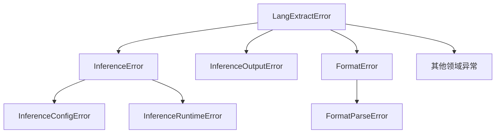

# 第 18 章　程序不是写完就结束了

快递站可以工作了。可是某天网络不通，有人提供了错误的表格，另一个同事还在使用旧版本接口。程序应该告诉他们哪里出了问题，而不是只显示「失败」。

这一章从三个方面整理项目工程设计：异常、调试日志、兼容层。最后建立测试和基准的阅读路线，为继续研究测试代码做好准备。

## 18.1 异常是另一种返回信息

```python
class StationError(Exception):
    pass

class ConfigurationError(StationError):
    pass

class WorkError(StationError):
    pass

def process(worker):
    if worker is None:
        raise ConfigurationError("没有配置工作人员")
    return worker()

try:
    process(None)
except ConfigurationError as e:
    assert "配置" in str(e)
```

错误类别决定调用者能采取什么措施。缺少必要配置时应先修正配置；网络暂时失败可能重试；原文无法对齐时可能仅报告部分结果。把它们全变为普通 Exception，会让调用者无法可靠地区分。

## 18.2 项目用什么异常表达不同阶段

源码出处：[langextract/core/exceptions.py:42–48](https://github.com/google/langextract/blob/b3499195e5ee711d3bb7da5178ba40456046f5f3/langextract/core/exceptions.py#L42-L48)。

````python
class LangExtractError(Exception):
  """Base exception for all LangExtract errors.

  All exceptions raised by LangExtract should inherit from this class.
  This allows users to catch all LangExtract-specific errors with a single
  except clause.
  """
````

LangExtractError 是项目共同异常基类，继承 Exception。调用者可捕获大多数项目领域错误。但这是一种设计约定，不代表源码所有 ValueError、IOError 或第 12 章 PromptAlignmentError 都继承它。

源码出处：[langextract/core/exceptions.py:51–52](https://github.com/google/langextract/blob/b3499195e5ee711d3bb7da5178ba40456046f5f3/langextract/core/exceptions.py#L51-L52)。

````python
class InferenceError(LangExtractError):
  """Base exception for inference-related errors."""
````
源码出处：[langextract/core/exceptions.py:55–60](https://github.com/google/langextract/blob/b3499195e5ee711d3bb7da5178ba40456046f5f3/langextract/core/exceptions.py#L55-L60)。

````python
class InferenceConfigError(InferenceError):
  """Exception raised for configuration errors.

  This includes missing API keys, invalid model IDs, or other
  configuration-related issues that prevent model instantiation.
  """
````

InferenceError 建立推理领域分支；InferenceConfigError 表示模型尚不能正确建立或配置不兼容，如工厂无法选择服务、缺少 SDK、显式规格和解析格式冲突。它不携带额外字段。

源码出处：[langextract/core/exceptions.py:99–122](https://github.com/google/langextract/blob/b3499195e5ee711d3bb7da5178ba40456046f5f3/langextract/core/exceptions.py#L99-L122)。

````python
class InferenceRuntimeError(InferenceError):
  """Exception raised for runtime inference errors.

  This includes API call failures, network errors, or other issues
  that occur during inference execution.
  """

  def __init__(
      self,
      message: str,
      *,
      original: BaseException | None = None,
      provider: str | None = None,
  ) -> None:
    """Initialize the runtime error.

    Args:
      message: Error message.
      original: Original exception from the provider SDK.
      provider: Name of the provider that raised the error.
    """
    super().__init__(message)
    self.original = original
    self.provider = provider
````

InferenceRuntimeError 代表真正执行模型请求期间的错误，__init__ 调父类保存 message，同时保留 original 原始异常与 provider 服务名。后两项为关键字参数，调用者无需从字符串中猜测供应商。raise ... from e 进一步保留 Python 异常因果链。

源码出处：[langextract/core/exceptions.py:125–130](https://github.com/google/langextract/blob/b3499195e5ee711d3bb7da5178ba40456046f5f3/langextract/core/exceptions.py#L125-L130)。

````python
class InferenceOutputError(LangExtractError):
  """Exception raised when no scored outputs are available from the language model."""

  def __init__(self, message: str):
    self.message = message
    super().__init__(self.message)
````

InferenceOutputError 直接继承 LangExtractError，而非 InferenceError；__init__ 显式保存 message 并调用父类。第 11 章在某个 prompt 没有候选输出时使用它。缺候选不是「候选存在但内容为空」。

源码出处：[langextract/core/exceptions.py:133–137](https://github.com/google/langextract/blob/b3499195e5ee711d3bb7da5178ba40456046f5f3/langextract/core/exceptions.py#L133-L137)。

````python
class InvalidDocumentError(LangExtractError):
  """Exception raised when document input is invalid.

  This includes cases like duplicate document IDs or malformed documents.
  """
````
源码出处：[langextract/core/exceptions.py:140–144](https://github.com/google/langextract/blob/b3499195e5ee711d3bb7da5178ba40456046f5f3/langextract/core/exceptions.py#L140-L144)。

````python
class InternalError(LangExtractError):
  """Exception raised for internal invariant violations.

  This indicates a bug in LangExtract itself rather than user error.
  """
````

InvalidDocumentError 表示文档无效（例如重复编号）；InternalError 表示项目内部不变量被破坏，应作为程序缺陷调查，不应一律要求用户修改输入。这两个类型没有额外成员，意义由异常类型表达。

源码出处：[langextract/core/exceptions.py:147–148](https://github.com/google/langextract/blob/b3499195e5ee711d3bb7da5178ba40456046f5f3/langextract/core/exceptions.py#L147-L148)。

````python
class ProviderError(LangExtractError):
  """Provider/backend specific error."""
````
源码出处：[langextract/core/exceptions.py:151–152](https://github.com/google/langextract/blob/b3499195e5ee711d3bb7da5178ba40456046f5f3/langextract/core/exceptions.py#L151-L152)。

````python
class SchemaError(LangExtractError):
  """Schema validation/serialization error."""
````

ProviderError 为具体后端问题的领域类型；SchemaError 表示规格验证或序列化问题。它们在共同基类下定义，使调用者可按服务与规格职责分类。

源码出处：[langextract/core/exceptions.py:155–156](https://github.com/google/langextract/blob/b3499195e5ee711d3bb7da5178ba40456046f5f3/langextract/core/exceptions.py#L155-L156)。

````python
class FormatError(LangExtractError):
  """Base exception for format handling errors."""
````
源码出处：[langextract/core/exceptions.py:159–168](https://github.com/google/langextract/blob/b3499195e5ee711d3bb7da5178ba40456046f5f3/langextract/core/exceptions.py#L159-L168)。

````python
class FormatParseError(FormatError):
  """Raised when format parsing fails.

  This consolidates all parsing errors including:
  - Missing fence markers when required
  - Multiple fenced blocks
  - JSON/YAML decode errors
  - Missing wrapper keys
  - Invalid structure
  """
````

FormatError 是格式处理分支；FormatParseError 表示解析失败，如要求的围栏缺失、JSON/YAML 解码失败、包装键不符合预期等。第 3 章 FormatHandler 使用这一区分，后续 resolver 可将格式解析异常转换为自身错误并按配置处理。



这里的其他领域异常包括 InvalidDocumentError、InternalError、ProviderError、SchemaError 及其他模块扩展的类型。

## 18.3 为什么有些函数返回异常而不是抛异常

第 13、14 章中，多个组件都要拒绝相同的配置组合。把统一的错误文本放在一个地方，可以防止不同入口检查同一规则时给出不同提示。

源码出处：[langextract/core/exceptions.py:63–68](https://github.com/google/langextract/blob/b3499195e5ee711d3bb7da5178ba40456046f5f3/langextract/core/exceptions.py#L63-L68)。

````python
def unsupported_output_schema_error(target: str) -> InferenceConfigError:
  """Builds a consistent error for providers without user-schema support."""
  return InferenceConfigError(
      f"{target} does not support output_schema. "
      "Built-in support is available for Gemini and OpenAI."
  )
````

unsupported_output_schema_error 接收目标名称，构造 InferenceConfigError，说明目标不支持显式 output_schema，并给出内置支持范围。它返回异常对象，由具体调用位置 raise。

源码出处：[langextract/core/exceptions.py:71–77](https://github.com/google/langextract/blob/b3499195e5ee711d3bb7da5178ba40456046f5f3/langextract/core/exceptions.py#L71-L77)。

````python
def output_schema_fence_error() -> InferenceConfigError:
  """Builds a consistent error for incompatible output schema fences."""
  return InferenceConfigError(
      "output_schema uses provider structured output/raw JSON and cannot be "
      "combined with fence_output=True. Leave fence_output unset or set "
      "fence_output=False."
  )
````
源码出处：[langextract/core/exceptions.py:80–85](https://github.com/google/langextract/blob/b3499195e5ee711d3bb7da5178ba40456046f5f3/langextract/core/exceptions.py#L80-L85)。

````python
def output_schema_format_error() -> InferenceConfigError:
  """Builds a consistent error for non-JSON explicit output schemas."""
  return InferenceConfigError(
      "output_schema uses provider structured output/raw JSON and requires "
      "format_type=JSON. Leave format_type unset or set format_type=JSON."
  )
````

前者产生显式规格不能和围栏输出同时使用的提示；后者产生显式规格需要 JSON 的提示。它们不负责实际检查格式，检查逻辑在工厂和格式处理器中。

源码出处：[langextract/core/exceptions.py:88–96](https://github.com/google/langextract/blob/b3499195e5ee711d3bb7da5178ba40456046f5f3/langextract/core/exceptions.py#L88-L96)。

````python
def output_schema_provider_kwargs_error(
    conflicting_keys: list[str],
) -> InferenceConfigError:
  """Builds a consistent error for duplicate provider schema controls."""
  return InferenceConfigError(
      "output_schema cannot be combined with provider kwargs that configure "
      f"provider schema output: {', '.join(conflicting_keys)}. Remove those "
      "provider kwargs and let output_schema configure structured output."
  )
````

接收冲突的 provider 参数名称列表，用逗号拼接后创建配置异常。调用者负责确定冲突键，不让错误构造器重复分析配置。

## 18.4 当程序失败时，怎样知道它做过什么？

假设分词器和对齐器的代码如下。每次排错都把 print 写进函数，既重复又污染核心逻辑。Python 装饰器可以为函数统一增加行为。

```python
from functools import wraps
from time import perf_counter

def measured(fn):
    @wraps(fn)
    def wrapper(*args, **kwargs):
        start = perf_counter()
        try:
            return fn(*args, **kwargs)
        finally:
            print(f"{fn.__name__}: {(perf_counter() - start)*1000:.2f}ms")
    return wrapper

@measured
def count(text):
    return len(text)

assert count("短信") == 2
assert count.__name__ == "count"
```

装饰器返回替代函数，但 functools.wraps 保留函数名等元数据。LangExtract 在 tokenizer 等组件上使用 debug_log_calls，把记录参数、返回值、耗时的工作从算法中移出。

## 18.5 日志应该简洁，并谨慎处理敏感数据

源码出处：[langextract/core/debug_utils.py:49–54](https://github.com/google/langextract/blob/b3499195e5ee711d3bb7da5178ba40456046f5f3/langextract/core/debug_utils.py#L49-L54)。

````python
def _safe_repr(obj: Any) -> str:
  """Truncate object repr for safe logging."""
  r = reprlib.Repr()
  r.maxstring = _MAX_STR
  r.maxlist = r.maxtuple = r.maxset = r.maxdict = _MAX_SEQ
  return r.repr(obj)
````

_safe_repr 建立 reprlib.Repr，限制字符串长度及列表、元组、集合、字典显示项数，以避免日志因冗长对象而膨胀。它只是截断表示，不是彻底的数据净化。

源码出处：[langextract/core/debug_utils.py:57–70](https://github.com/google/langextract/blob/b3499195e5ee711d3bb7da5178ba40456046f5f3/langextract/core/debug_utils.py#L57-L70)。

````python
def _redact_value(name: str, value: Any) -> str:
  """Redact sensitive values based on parameter name."""
  if isinstance(name, str) and name.lower() in _REDACT_KEYS:
    return "<REDACTED>"
  # If a nested mapping, redact its sensitive keys too
  if isinstance(value, Mapping):
    redacted = {}
    for k, v in value.items():
      if isinstance(k, str) and k.lower() in _REDACT_KEYS:
        redacted[k] = "<REDACTED>"
      else:
        redacted[k] = _safe_repr(v)
    return _safe_repr(redacted)
  return _safe_repr(value)
````

_redact_value 根据参数名称与预设敏感键集合匹配，返回固定脱敏标记；映射值也按预设键进行脱敏，其他值取简短表示。目的是让常见认证配置不直接出现在调试参数中，不保证所有任意对象或深层敏感内容安全。不要将调试日志视为脱敏后的公开数据。

源码出处：[langextract/core/debug_utils.py:73–78](https://github.com/google/langextract/blob/b3499195e5ee711d3bb7da5178ba40456046f5f3/langextract/core/debug_utils.py#L73-L78)。

````python
def _redact_mapping(mapping: Mapping[str, Any]) -> dict[str, str]:
  """Replace sensitive values with <REDACTED>."""
  out = {}
  for k, v in mapping.items():
    out[k] = _redact_value(k, v)
  return out
````

_redact_mapping 逐项应用 _redact_value，构造新的映射而不改变调用者的原参数。它用于不能完成签名绑定时整理关键字参数。

源码出处：[langextract/core/debug_utils.py:81–103](https://github.com/google/langextract/blob/b3499195e5ee711d3bb7da5178ba40456046f5f3/langextract/core/debug_utils.py#L81-L103)。

````python
def _format_bound_args(
    fn: Callable, args: tuple[Any, ...], kwargs: dict[str, Any]
) -> str:
  """Format function arguments using signature inspection."""
  try:
    sig = inspect.signature(fn)
    bound = sig.bind_partial(*args, **kwargs)
    bound.apply_defaults()
  except Exception:
    # Fallback (no names) if binding fails
    parts = [_safe_repr(a) for a in args]
    if kwargs:
      red = _redact_mapping(kwargs)
      parts += [f"{k}={v}" for k, v in sorted(red.items())]
    return ", ".join(parts)

  parts: list[str] = []
  for name, value in bound.arguments.items():
    if name in ("self", "cls"):
      parts.append(f"{name}=<{type(value).__name__}>")
    else:
      parts.append(f"{name}={_redact_value(name, value)}")
  return ", ".join(parts)
````

_format_bound_args 使用 inspect.signature(fn) 获取函数声明，bind_partial 把位置参数与关键字参数对应到正式名称，apply_defaults 填充默认值。这样日志可按参数名阅读和脱敏。self/cls 只显示类型名称，避免打印整个模型对象。

绑定失败时仍尽力为位置参数生成表示、为关键字参数调用脱敏映射，并排序拼接。调试工具不应该因无法格式化参数就阻止原函数运行。生产系统仍应避免记录敏感业务数据。

## 18.6 将记录过程装到函数外面

源码出处：[langextract/core/debug_utils.py:106–148](https://github.com/google/langextract/blob/b3499195e5ee711d3bb7da5178ba40456046f5f3/langextract/core/debug_utils.py#L106-L148)。

````python
def debug_log_calls(fn: Callable) -> Callable:
  """Log function calls with redacted sensitive data and timing.

  Automatically redacts api_key, token, etc. and truncates large outputs.
  """

  @functools.wraps(fn)
  def wrapper(*args, **kwargs):
    logger = _LOG
    if not logger.isEnabledFor(logging.DEBUG):
      return fn(*args, **kwargs)

    fn_qual = getattr(fn, "__qualname__", fn.__name__)
    mod = getattr(fn, "__module__", "")

    # Format arguments using signature inspection
    arg_str = _format_bound_args(fn, args, kwargs)

    logger.debug("[%s] CALL: %s(%s)", mod, fn_qual, arg_str, stacklevel=2)

    start = time.perf_counter()
    try:
      result = fn(*args, **kwargs)
    except Exception:
      dur_ms = (time.perf_counter() - start) * 1000
      logger.exception(
          "[%s] EXCEPTION: %s (%.1f ms)", mod, fn_qual, dur_ms, stacklevel=2
      )
      raise

    dur_ms = (time.perf_counter() - start) * 1000
    result_repr = _safe_repr(result)
    logger.debug(
        "[%s] RETURN: %s -> %s (%.1f ms)",
        mod,
        fn_qual,
        result_repr,
        dur_ms,
        stacklevel=2,
    )
    return result

  return wrapper
````

debug_log_calls 返回内部 wrapper；wrapper 用 functools.wraps 保留元信息。在 DEBUG 未启用时直接调用原函数，不检查签名或计时，降低常规运行开销。

启用时记录模块和函数限定名、格式化参数，使用 perf_counter 计时。异常发生时记录堆栈和耗时并原样 raise；成功则记录截断后的返回值、耗时，再返回原值。这个 wrapper 保持业务结果不变，但对生成器只测量生成器创建过程，不会自动测到其全部迭代耗时。

源码出处：[langextract/core/debug_utils.py:151–185](https://github.com/google/langextract/blob/b3499195e5ee711d3bb7da5178ba40456046f5f3/langextract/core/debug_utils.py#L151-L185)。

````python
def configure_debug_logging() -> None:
  """Enable debug logging for the 'langextract' namespace only."""
  logger = logging.getLogger("langextract")

  # Skip if we already added our handler
  our_handler_exists = any(
      isinstance(h, logging.StreamHandler)
      and getattr(h, "langextract_debug", False)
      for h in logger.handlers
  )
  if our_handler_exists:
    return

  # Respect host handlers - only set level if they exist
  non_null_handlers = [
      h for h in logger.handlers if not isinstance(h, logging.NullHandler)
  ]

  if non_null_handlers:
    logger.setLevel(logging.DEBUG)
  else:
    logger.setLevel(logging.DEBUG)
    handler = logging.StreamHandler()
    handler.setLevel(logging.DEBUG)
    fmt = "%(asctime)s - %(name)s - %(levelname)s - %(message)s"
    handler.setFormatter(logging.Formatter(fmt))
    handler.langextract_debug = True
    logger.addHandler(handler)
    logger.propagate = False

  # Best-effort absl configuration
  try:
    absl_logging.set_verbosity(absl_logging.DEBUG)
  except Exception:
    pass
````

configure_debug_logging 取得 langextract logger。若已找到带 langextract_debug 标记的自建 StreamHandler 就不重复添加；已有非 NullHandler 时调整级别以尊重宿主的日志配置，否则安装带时间、名称、级别、消息的 handler，关闭传播。

同时尽力设置 absl 的调试级别，失败忽略。开启后状态持续存在于进程中，并非仅对某一次 extract 临时有效；第 11 章入口在 debug=True 时调用它。

## 18.7 新版本重构目录，旧代码怎么办？

用户早期也许这样写：

```python
# 旧版接口的示意（不执行）
# from langextract.inference import BaseLanguageModel
```

后来项目把 BaseLanguageModel 移到 core/base_model.py。直接删掉旧名字可能破坏成千上万个使用者的程序。兼容层将旧访问转发到新位置，同时提醒迁移。

Python 模块可以实现 __getattr__，当模块没有找到普通属性时才触发。它和类的 __getattr__ 类似。

```python
from types import ModuleType

module = ModuleType("demo")
def get_missing(name):
    if name == "old":
        return 42
    raise AttributeError(name)
module.__getattr__ = get_missing
assert module.old == 42
assert not hasattr(module, "unknown")
```

## 18.8 顶层接口与子模块的延迟访问

源码出处：[langextract/__init__.py:53–55](https://github.com/google/langextract/blob/b3499195e5ee711d3bb7da5178ba40456046f5f3/langextract/__init__.py#L53-L55)。

````python
def extract(*args: Any, **kwargs: Any):
  """Top-level API: lx.extract(...)."""
  return extract_func(*args, **kwargs)
````
源码出处：[langextract/__init__.py:58–60](https://github.com/google/langextract/blob/b3499195e5ee711d3bb7da5178ba40456046f5f3/langextract/__init__.py#L58-L60)。

````python
def visualize(*args: Any, **kwargs: Any):
  """Top-level API: lx.visualize(...)."""
  return visualization.visualize(*args, **kwargs)
````

顶层 extract(*args, **kwargs) 将参数不加修改地交给第 11 章 extract_func；visualize 同样转发给第 17 章实现。这样用户可写 lx.extract、lx.visualize 而不用了解内部模块位置。它们不是重复实现。

源码出处：[langextract/__init__.py:87–98](https://github.com/google/langextract/blob/b3499195e5ee711d3bb7da5178ba40456046f5f3/langextract/__init__.py#L87-L98)。

````python
def __getattr__(name: str) -> Any:
  if name in _CACHE:
    return _CACHE[name]
  modpath = _LAZY_MODULES.get(name)
  if modpath is None:
    raise AttributeError(f"module {__name__!r} has no attribute {name!r}")
  module = importlib.import_module(modpath)
  # ensure future 'import langextract.<name>' returns the same module
  sys.modules[f"{__name__}.{name}"] = module
  setattr(sys.modules[__name__], name, module)
  _CACHE[name] = module
  return module
````

顶层 __getattr__ 先查 _CACHE，再从 _LAZY_MODULES 找导入路径；没有名字抛 AttributeError。成功 import 后将模块记录于 sys.modules 的对应名称，设置当前包属性并加入缓存，后续访问得到同一模块对象。注意包顶层已经导入 extraction 和 visualization，不能把所有依赖都称为完全延迟加载。

源码出处：[langextract/__init__.py:101–102](https://github.com/google/langextract/blob/b3499195e5ee711d3bb7da5178ba40456046f5f3/langextract/__init__.py#L101-L102)。

````python
def __dir__():
  return sorted(__all__)
````

__dir__ 返回排序后的 __all__，让 dir(lx) 列出面向用户的公开名称。它改善交互体验，不代表其他内部名称真的不存在。

## 18.9 旧 inference 如何转发

源码出处：[langextract/_compat/inference.py:23–27](https://github.com/google/langextract/blob/b3499195e5ee711d3bb7da5178ba40456046f5f3/langextract/_compat/inference.py#L23-L27)。

````python
class InferenceType(enum.Enum):
  """Enum for inference types - kept for backward compatibility."""

  ITERATIVE = "iterative"
  MULTIPROCESS = "multiprocess"
````

InferenceType 保留 ITERATIVE/MULTIPROCESS 字符串枚举以兼容旧调用。仅有枚举不代表当前所有 provider 实现都支持进程池模式；第 15 章的实际推理路径才决定执行方式。

源码出处：[langextract/_compat/inference.py:30–61](https://github.com/google/langextract/blob/b3499195e5ee711d3bb7da5178ba40456046f5f3/langextract/_compat/inference.py#L30-L61)。

````python
def __getattr__(name: str):
  moved = {
      "BaseLanguageModel": ("langextract.core.base_model", "BaseLanguageModel"),
      "ScoredOutput": ("langextract.core.types", "ScoredOutput"),
      "InferenceOutputError": (
          "langextract.core.exceptions",
          "InferenceOutputError",
      ),
      "GeminiLanguageModel": (
          "langextract.providers.gemini",
          "GeminiLanguageModel",
      ),
      "OpenAILanguageModel": (
          "langextract.providers.openai",
          "OpenAILanguageModel",
      ),
      "OllamaLanguageModel": (
          "langextract.providers.ollama",
          "OllamaLanguageModel",
      ),
  }
  if name in moved:
    mod, attr = moved[name]
    warnings.warn(
        f"`langextract.inference.{name}` is deprecated and will be removed in"
        f" v2.0.0; use `{mod}.{attr}` instead.",
        FutureWarning,
        stacklevel=2,
    )
    module = __import__(mod, fromlist=[attr])
    return getattr(module, attr)
  raise AttributeError(name)
````

内部兼容函数把旧 BaseLanguageModel、ScoredOutput、InferenceOutputError 及三个 provider 类名映射到新模块与属性。已知名发 FutureWarning（stacklevel=2 将提醒指向调用路径），按需导入并返回真实类型；未知名报 AttributeError。

源码出处：[langextract/inference.py:26–32](https://github.com/google/langextract/blob/b3499195e5ee711d3bb7da5178ba40456046f5f3/langextract/inference.py#L26-L32)。

````python
def __getattr__(name: str):
  """Forward to _compat.inference for backward compatibility."""
  # Handle InferenceType specially since it's defined in _compat
  if name == "InferenceType":
    return inference.InferenceType

  return inference.__getattr__(name)
````

公开旧模块特殊处理 InferenceType，直接返回兼容层枚举；其他名字交给内部 __getattr__。两层分开使入口薄而统一迁移逻辑。

## 18.10 registry 与 exceptions 的兼容

源码出处：[langextract/_compat/registry.py:25–33](https://github.com/google/langextract/blob/b3499195e5ee711d3bb7da5178ba40456046f5f3/langextract/_compat/registry.py#L25-L33)。

````python
def __getattr__(name: str):
  """Forward to plugins module with deprecation warning."""
  warnings.warn(
      "`langextract.registry` is deprecated and will be removed in v2.0.0; "
      "use `langextract.plugins` instead.",
      FutureWarning,
      stacklevel=2,
  )
  return getattr(plugins, name)
````
源码出处：[langextract/registry.py:28–36](https://github.com/google/langextract/blob/b3499195e5ee711d3bb7da5178ba40456046f5f3/langextract/registry.py#L28-L36)。

````python
def __getattr__(name: str):
  """Redirect to plugins module with deprecation warning."""
  warnings.warn(
      "`langextract.registry` is deprecated and will be removed in v2.0.0; "
      "use `langextract.plugins` instead.",
      FutureWarning,
      stacklevel=2,
  )
  return getattr(plugins, name)
````

这两个模块各自有转发函数，均发 FutureWarning 并将属性查询委托给 plugins。旧 registry 这里指名称发现接口（第 14 章），不要与 providers.router 的运行时模型分派表混淆。

源码出处：[langextract/_compat/exceptions.py:26–44](https://github.com/google/langextract/blob/b3499195e5ee711d3bb7da5178ba40456046f5f3/langextract/_compat/exceptions.py#L26-L44)。

````python
def __getattr__(name: str):
  allowed = {
      "LangExtractError",
      "InferenceError",
      "InferenceConfigError",
      "InferenceRuntimeError",
      "InferenceOutputError",
      "ProviderError",
      "SchemaError",
  }
  if name in allowed:
    warnings.warn(
        "`langextract.exceptions` is deprecated; import from"
        " `langextract.core.exceptions`.",
        FutureWarning,
        stacklevel=2,
    )
    return getattr(exceptions, name)
  raise AttributeError(name)
````

内部 exceptions 兼容函数维护允许的旧异常名集合，匹配时发 FutureWarning、从 core.exceptions 取真实类型；其余抛 AttributeError。公开 exceptions.py 自身使用重新导出方式；不能把两者误认为分别定义了一套不同异常类。

## 18.11 schema 的兼容与新接口

源码出处：[langextract/_compat/schema.py:23–41](https://github.com/google/langextract/blob/b3499195e5ee711d3bb7da5178ba40456046f5f3/langextract/_compat/schema.py#L23-L41)。

````python
def __getattr__(name: str):
  moved = {
      "BaseSchema": ("langextract.core.schema", "BaseSchema"),
      "Constraint": ("langextract.core.schema", "Constraint"),
      "ConstraintType": ("langextract.core.schema", "ConstraintType"),
      "EXTRACTIONS_KEY": ("langextract.core.schema", "EXTRACTIONS_KEY"),
      "GeminiSchema": ("langextract.providers.schemas.gemini", "GeminiSchema"),
  }
  if name in moved:
    mod, attr = moved[name]
    warnings.warn(
        f"`langextract.schema.{name}` is deprecated and will be removed in"
        f" v2.0.0; use `{mod}.{attr}` instead.",
        FutureWarning,
        stacklevel=2,
    )
    module = __import__(mod, fromlist=[attr])
    return getattr(module, attr)
  raise AttributeError(name)
````

内部旧规格名映射到 core/schema 或 Gemini provider 的规格模块，使用警告和延迟导入。未知名称报 AttributeError。这是历史接口维护，不是最新 schema 构造逻辑。

源码出处：[langextract/schema.py:57–82](https://github.com/google/langextract/blob/b3499195e5ee711d3bb7da5178ba40456046f5f3/langextract/schema.py#L57-L82)。

````python
def __getattr__(name: str):
  """Handle imports with appropriate warnings."""
  core_items = {
      "BaseSchema": ("langextract.core.schema", "BaseSchema"),
      "Constraint": ("langextract.core.schema", "Constraint"),
      "ConstraintType": ("langextract.core.schema", "ConstraintType"),
      "EXTRACTIONS_KEY": ("langextract.core.data", "EXTRACTIONS_KEY"),
      "ATTRIBUTE_SUFFIX": ("langextract.core.data", "ATTRIBUTE_SUFFIX"),
      "FormatModeSchema": ("langextract.core.schema", "FormatModeSchema"),
  }

  if name in core_items:
    mod, attr = core_items[name]
    warnings.warn(
        f"`langextract.schema.{name}` has moved to `{mod}.{attr}`. Please"
        " update your imports. This compatibility layer will be removed in"
        " v2.0.0.",
        FutureWarning,
        stacklevel=2,
    )
    module = __import__(mod, fromlist=[attr])
    return getattr(module, attr)
  elif name == "GeminiSchema":
    return schema.__getattr__(name)

  raise AttributeError(f"module 'langextract.schema' has no attribute '{name}'")
````

公开 schema 模块直接重新导出 output_schema 的便利函数及类型，另外为旧核心规格类型、常量提供 __getattr__ 映射；GeminiSchema 转给旧兼容模块处理。通过共同实现返回原对象，不需要用户维护两个规格类之间的转换。

## 18.12 用测试来证明我们理解了源码

前面的教学实验只演示了关键机制。要让项目长期能修改，还应验证一系列不变量。下面先写个与项目无关的最小 unittest：

```python
import unittest

def overlap(a, b):
    return a[0] < b[1] and b[0] < a[1]

class IntervalTests(unittest.TestCase):
    def test_adjacent(self):
        self.assertFalse(overlap((0, 2), (2, 4)))

    def test_intersecting(self):
        self.assertTrue(overlap((0, 3), (2, 4)))

suite = unittest.defaultTestLoader.loadTestsFromTestCase(IntervalTests)
result = unittest.TestResult()
suite.run(result)
assert result.wasSuccessful() and result.testsRun == 2
```

测试不只是表明某个函数在普通输入下运行，还要把边界条件变成可重复的断言。比如半开区间相邻不重叠，这比「应该正确处理范围」更精确。

推荐回到固定提交的 tests 目录，按业务问题而非文件排列顺序阅读：

| 已学机制 | 对应测试入口 |
|---|---|
| 分词和句界 | tests/tokenizer_test.py |
| 切块与原文坐标 | tests/chunking_test.py |
| 精确、模糊对齐 | tests/resolver_test.py、tests/fuzzy_alignment_cases_test.py |
| 流水线和去重 | tests/annotation_test.py |
| 规格与配置选择 | tests/schema_test.py、tests/factory_schema_test.py |
| 序列化与显示 | tests/data_lib_test.py、tests/io_test.py、tests/visualization_test.py |
| Provider 即时与批任务 | tests/inference_test.py、tests/openai_batch_test.py、tests/test_gemini_batch_api.py |

测试中的 mock/fake 对象往往能帮助我们阅读接口：编造一份 SDK 回复，让 infer 正常接收它，就可以在没有模型账号的情况下研究输出顺序和错误处理。真实服务的集成测试还有外部依赖、认证和可能产生费用，应明确区分，不是每次学习都去实际调用。

## 18.13 为什么还要有 Benchmark

单元测试回答「结果是否符合预期」，基准测试回答「输入规模改变时，时间、资源或效果怎样变化」。第 9 章的 occurrence DP、第 10 章的 LCS，对长文的成本不同；切块长度也改变处理量和证据范围。项目 benchmarks 目录提供进一步的性能与效果评估资料。

以下是一个最小的计时实验，只用标准库，不代表项目的真实基准结果：

```python
from timeit import timeit

text = "短信 3821 " * 100
elapsed = timeit(lambda: text.count("3821"), number=100)
assert elapsed >= 0
```

做真实比较前，应固定模型、数据、硬件、配置与运行次数，并区分文本长度、抽取准确性和运行耗时。一次结果不足以证明某个算法一定更好；测试不同长度和重复率，才容易发现性能变化。

## 18.14 扩展时从哪里开始？

阅读完运行包之后，可以尝试写一个最小本地假 provider：遵守 BaseLanguageModel.infer 接口，对每个 prompt 返回固定结构的 ScoredOutput；先手动传给 extract，然后再研究 router 注册、entry point 发现和可选规格支持。

固定提交的 examples/custom_provider_plugin 提供扩展参考，skills/langextract-usage/examples 提供用法案例；它们属于运行包之外的代码，后续可与测试和基准一起逐一展开。

至此，第 1—18 章构成完整的运行包阅读路线，从短信到数据、模型、对齐、存储、展示及维护。回头看整个架构，每个组件的职责其实很小：设计的关键在于让它们通过稳定的数据结构与接口合作。

本章的测试及基准部分是阅读路线，而不是逐个测试定义的教学讲解；因此不计入测试和辅助代码覆盖率。
